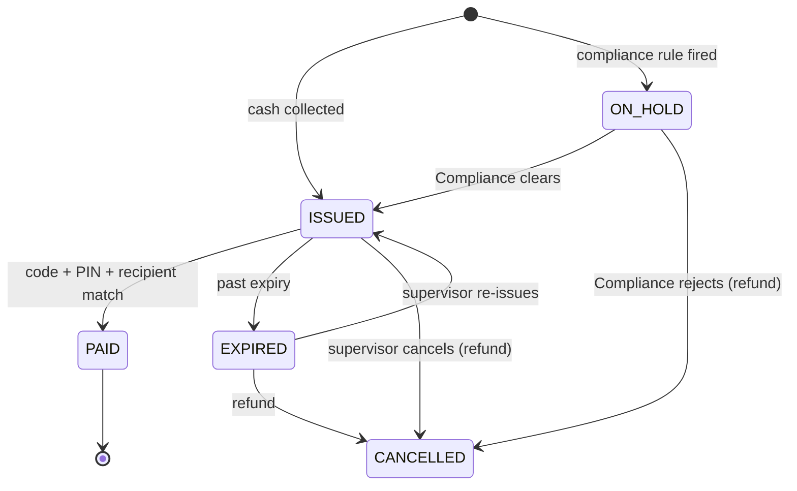

# Network, Currency & Transfers Specification
*Version 1.0 · 31 October 2026*

## 1. Principles
1. Every branch is both a **send point** and a **payout point**.
2. A transfer is *collected in any currency* and *paid in any currency*. Neither has to be the local currency of either country.
3. Any country to any country, including **the same country**.
4. Countries can have many branches. Adding one is an admin action, not a software change.
5. Money is only ever released to a recipient who knows the code **and** matches the recipient details given at the send point.

## 2. Network model
- **Country**: code, name, local currency, timezone, dial code.
- **Branch**: `CC-XXX` id (e.g. `GM-SKD`), country, type OWN or AGENT, agent commission (basis points of payout), opening hours and days in *local time*, active flag.
- **Currency**: ISO code, decimals (0, 2 or 3), rate per 1 US dollar (sandbox; replaced by a live feed).
- Starting data: 12 currencies, 12 countries, 19 branches (The Gambia 3, Senegal 2, Mali 1, Guinea-Bissau 1, Guinea 1, Zambia 2, UK 2, USA 2, China 2, Germany 1, France 1, UAE 1).
- **Payout rule**: a transfer is payable in the destination country. The sender may pick one branch or leave it open (any active branch in that country).

## 3. Pricing
- Cross rates go through US dollars: `rate(from→to) = perUsd(to) / perUsd(from)`, then reduced by the FX margin (default 1.5%, overrides per pair `FROM>TO`, `*>TO`, `FROM>*`). Same currency → no margin.
- Fee bands (US-dollar equivalent of the amount): up to 100 → 3; up to 500 → 5; up to 2,000 → 8; above → 12. Same-country factor 0.5. Minimum 1.
- Two modes: **Send** (customer says how much to send; fee on top) and **Receive** (customer says how much the family must get; system works backwards).
- The quote is locked for 30 minutes (admin setting).
- All money is stored as whole minor units (no decimals in math).

## 4. Transfer lifecycle

A **locked** flag (3 wrong tries) sits on top of ISSUED until a supervisor unlocks or re-issues.

## 5. Payout procedure (what the system enforces)
1. Cashier types the code → system shows amount, masked sender, masked recipient hint. It never shows the full recipient name.
2. Cashier asks the recipient for ID, types name, phone, ID type and number, and the Release PIN the recipient holds.
3. Checks, in order: branch is in the destination country (and the chosen branch); issuer ≠ payer; PIN correct; recipient match.
4. Recipient match: name score ≥ 0.92 and phone and ID agree → **PASS**. Name 0.80–0.92 with phone/ID agreeing → **supervisor must confirm in person**. Otherwise **FAIL**: no cash, attempt counted.
5. Cash float at the branch must cover the payout, else refused with a low-float alert.
6. On success: journal posted, PIN hash erased, code tombstoned (cannot be used again), SMS to both sides (simulated).

## 6. Ledger
Accounts: `CASH:branch:ccy`, `PAYABLE:ccy`, `FX_POS:ccy`, `REV_FEES:ccy`, `REV_FX:ccy`, `EXP_COMM:ccy`, `COMM_PAYABLE:branch:ccy`, `HQ_FUNDING:ccy`, `SUSPENSE_VARIANCE:ccy`.
| Event | Entries |
|---|---|
| Collect (src currency) | Dr CASH total · Cr PAYABLE principal · Cr REV_FEES fee |
| FX sell (src) | Dr PAYABLE principal · Cr FX_POS principal |
| FX buy (dst) | Dr FX_POS payout-at-mid · Cr PAYABLE payout · Cr REV_FX margin |
| Payout (dst) | Dr PAYABLE payout · Cr CASH branch |
| Agent commission | Dr EXP_COMM · Cr COMM_PAYABLE |
| Refund | reverse FX legs; Dr PAYABLE (+ REV_FEES if fee refunded) · Cr CASH |
Each journal must balance within its own currency; the screen shows a per-currency trial balance.

## 7. Compliance rules in the engine
KYC tiers C1 (name+phone) / C2 (+ID) / C3 (+photo, purpose, source of funds); per-transfer, 30-day and 12-month limits; hard maximum; second approver above a threshold; holds for velocity (24h, 7d), structuring (several just under the limit), many-to-one, one-to-many, high value, PEP match; hard block on sanctions match (no transfer, alert raised, cashier told only to refer). All thresholds are admin settings.

## 8. Known limits of this build
Single browser, no server; demo watch-lists; sandbox FX; SMS is simulated; branch hours use each country's timezone (daylight changes handled by the browser).
