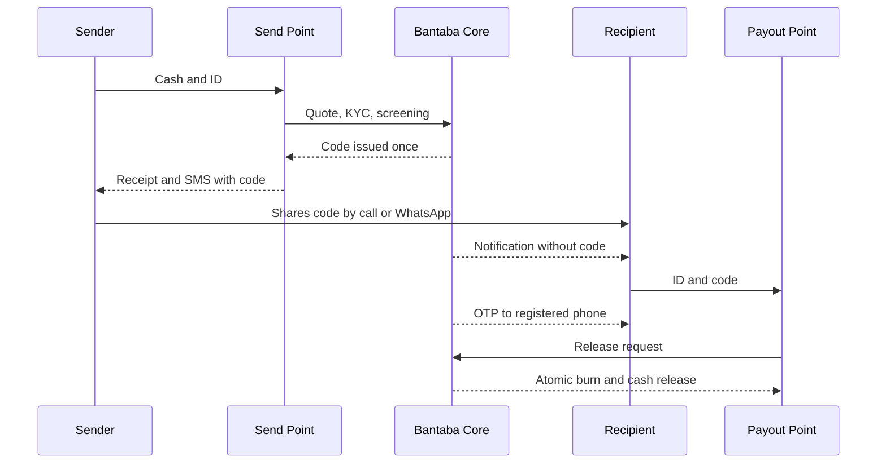

# 1. The idea in one page

**Bantaba is a remittance company.** A person living in London, Guangzhou or Atlanta who wants to support family in The Gambia walks into a Bantaba **Send Point**, shows identification, and hands cash to a Bantaba staff member. The system issues a one-time **Bantaba Code**. The sender passes the code to the family member by phone or WhatsApp. The family member goes to any Bantaba **Payout Point** in the destination country, shows ID, confirms a one-time password sent to their own registered phone, and is paid cash. The instant the money is paid, the code is **nullified (burned)** and can never be used again.

The product line is **"Cash in. Code out. Family paid."** The tagline is **"Home, within reach."**

A *bantaba* is the shaded meeting place at the heart of Mandinka and Senegambian villages, under a great tree, where news is shared and where family obligations and money decisions are discussed. The name is chosen on purpose. Sending money home is a family conversation, not a technical transaction, and Bantaba wants to be the trusted place where that conversation turns into support that arrives.

| Question | Answer in one line |
|---|---|
| What is it? | A cash-to-cash money transfer service for West African families, with a technology backbone called **Bantaba Core**. |
| Who is it for? | Senders aged 28 to 55 in the UK, China and the USA supporting family in The Gambia, and later Senegal, Guinea and Guinea-Bissau; and the recipients at home. |
| What problem does it solve? | High all-in cost (roughly 6 to 8% in the market, per World Bank data, verify latest quarter), weak trust in unfamiliar channels, and poor access to a reliable payout point near the family. |
| What is the innovation? | The single-use **Bantaba Code**, protected by two independent channels, human ID checks and an atomic burn on redemption. |
| What does it charge? | A flat fee by amount band plus a 1.5% FX margin: an all-in target of **3 to 4.5%**, about half the market average. |
| What does it need? | US$4.0M seed to build Bantaba Core, secure licences, open the first Send Points and Payout Points, and pre-fund payout float. |

This document explains the thinking behind the company: what we are building, the problem, the insight that shapes the design, why we begin with cash, why the code matters, and where the company goes over a five-year horizon. Detailed plans are in the Business Plan (BNT-STR-03), the Market Analysis (BNT-STR-07) and the Financial Plan (BNT-STR-10).

# 2. What Bantaba is, and what it is not

Clear positioning prevents the most common misunderstanding about the business, so it is stated directly.

**Bantaba is** a remittance company, a money transfer service and a family-support money transfer. Its assets are people, premises, a cash network, compliance discipline and a trusted brand. Its technology, **Bantaba Core**, is a back-office tool that makes the service accurate, auditable and fast.

**Bantaba is not** an app-first company, a neo-bank, a digital wallet or a payments platform. We do not ask a customer to download anything to send money in Phase 1. A grandmother in Basse and a care worker in Croydon should both be able to use the service using a phone call, a receipt and a trusted face at a counter.

This matters for three reasons.

1. **It matches how customers behave.** Many senders in our target communities are paid in cash or in irregular patterns, hold limited-purpose bank accounts, or simply prefer to hand money to a person they can look in the eye. Many recipients have a feature phone, no bank account and a cash-based household economy.
2. **It matches where the moat is.** Apps can be copied in a quarter. A licensed network of staffed premises, vetted agents, pre-funded float, a compliance programme that regulators trust, and community reputation take years to build and cannot be copied by a download.
3. **It matches the capital plan.** A cash-first company spends on premises, people and float, which can be measured, insured and audited, rather than on paid acquisition to rent customers from app stores.

## 2.1 The product suite

| Name | What it is | Phase |
|---|---|---|
| **Bantaba Send** | The consumer service: send cash at a Send Point, receive a Bantaba Code. Later also through an app or WhatsApp with card or open-banking pay-in | Phase 1 at the counter; Phase 2 app |
| **Bantaba Points** | The network of Send Points and Payout Points, company-owned and authorised agents | Phase 1 |
| **Bantaba Agents** | The agent programme: onboarding, float, commission, training | Phase 1 |
| **Bantaba Code** | The single-use redemption code, the core innovation | Phase 1 |
| **Bantaba Core** | The internal platform: staff console, quote and FX engine, ledger, code service, compliance, treasury and reporting | Phase 1 |
| **Bantaba Business** | Bulk payouts for employers, NGOs and associations | Phase 3 |

## 2.2 Lineage

Bantaba's technical design descends from the *AuraRemit System Architecture and Technical Blueprint* (input document), which had the right remittance framing: intake, a logic engine with a ledger, and a payout service, on a PostgreSQL ledger with strong encryption, role-based access, an immutable audit trail and redemption tokens. In Bantaba those become the Send Point Service with KYC and screening, the Quote and FX Engine with the Ledger, and the Payout and Code Service. "Aura" survives only as a historical codename. The commercial thinking draws on *Bantaba: Cross-Border Payments Venture Blueprint v1.0* (October 2026, input document), from which this plan departs in the ways listed in section 12.

# 3. The problem

## 3.1 Families depend on money from abroad

The Gambia is among the most remittance-dependent economies in the world. According to the Central Bank of The Gambia, formal remittance inflows reached **US$872.05 million in 2025**, up US$54.4 million on 2024, which is **more than 30% of GDP**. In 2024 the figure was US$775.6 million, about 31.5% of GDP, as stated by the CBG Governor. These figures cover formal channels only; informal flows, carried by traders, travellers and drivers, are additional. For many households this money pays for food, rent, school fees, medical care, weddings, funerals and the building of a family compound. It is not discretionary spending. It is the household budget.

## 3.2 The cost is high and often opaque

World Bank *Remittance Prices Worldwide* data put the global average cost of sending about US$200 at roughly 6 to 7%, and Sub-Saharan Africa at around 8% (verify latest quarter). The UN Sustainable Development Goal target is 3%. On a stream of this size even small percentage differences are large: on US$872 million, each percentage point of cost is about US$8.7 million a year that either stays with families or leaves their budget. The headline fee is only part of the cost; the exchange rate margin is often hidden in the rate offered, so the customer sees a low fee and a poor rate and cannot tell what they are paying.

## 3.3 Trust and access are not solved by cheaper apps

Cheaper digital services exist and have improved the market for banked, smartphone-using senders. They do not fully serve the people at the centre of our target market, for four reasons.

| Gap | What happens today |
|---|---|
| **Cash is the sender's reality** | A sender paid in cash, or with a basic account, cannot always fund an app transfer easily or is reluctant to try a new online service for family money. |
| **Verification friction** | App onboarding can stall on document uploads, selfie checks and address proof, and customers abandon rather than call a helpline. |
| **Pickup uncertainty at home** | The recipient wants to know where to go, what to carry, and that the person at the counter will pay without a dispute. A reference number copied from an SMS is weak comfort. |
| **Fear of fraud** | Customers know someone who lost money to a scam. They want a person, a premises and a receipt. |

Informal channels fill the gap: a friend travelling home, a trader who settles accounts later, a driver who carries envelopes. They are personal and fast but unregulated, unprotected, and exposed to loss, theft and sanction risk. The remittance market is therefore a trust market before it is a technology market.

## 3.4 The specific weakness in cash pickup

Traditional cash pickup uses a reference number and a recipient's name. If the number is shared too widely, intercepted, or read out to the wrong person, funds can be taken by someone else, and the dispute that follows is hard to resolve because nothing proves who held the secret. Agents also face the reverse problem: paying out without a strong, auditable control. Both sides need a mechanism that is simple to use and difficult to abuse. That mechanism is the Bantaba Code.

# 4. The insight

Bantaba rests on three connected insights.

**Insight 1: Customers in this corridor trust people and places.** A sender who hands cash to a known face at a staffed counter, receives a printed receipt, and sees the family paid at a recognisable Payout Point has all the proof they need. Technology should support that experience, not replace it.

**Insight 2: The cost of a trusted network can be paid for by a lower margin than the market charges.** Cash handling is more expensive than digital pay-in, and we price accordingly. But the all-in price of 3 to 4.5% is roughly half the market average of 6 to 8% because Bantaba does not carry expensive paid acquisition, does not fund a large consumer-app engineering team in Phase 1, and keeps the take rate transparent: a flat fee by band and a stated FX margin.

**Insight 3: A one-time code with two independent channels gives the security of a bank-grade release with the simplicity of a number.** Because the code is single-use, delivered to the sender, and protected by an OTP sent separately to the recipient and an ID check by a human officer, a stolen number is not enough to take money. Because it burns on redemption, the question "has this been paid?" has a single, auditable answer.

Together these give a service customers can trust on day one and a company regulators and partners can audit.

# 5. Why cash first

Phase 1 begins with staffed Send Points and cash, not with an app. The reasons are commercial and practical.

1. **Revenue starts with the first customer.** A Send Point can take its first transfer when it is licensed, staffed and connected to Bantaba Core. An app requires licensing for card and open-banking pay-in, payment partner onboarding, app store review and a large acquisition spend before the first dollar of revenue.
2. **It targets the underserved segment.** Customers who already use digital apps have options; customers who prefer cash and a human have fewer. A cash-first entry gets a loyal base that is cheap to retain.
3. **It builds the moat early.** Premises, agent relationships, float and compliance experience are assets competitors cannot replicate quickly. By the time the Bantaba Send app launches in Phase 2, the brand has trust and the network has density.
4. **It keeps the architecture.** The design system, APIs and security model of the digital blueprint are kept. The app in Phase 2 becomes another channel into the same Bantaba Core, adding card and open-banking pay-in and wallet payout.
5. **It manages regulatory risk in sequence.** UK send starts through an FCA-authorised payment institution partner or agent arrangement while Bantaba's own application proceeds (typically 9 to 12 months, verify). The simple model, cash in and cash out, is the easiest to explain to a regulator.

Cash-first is more capital-intensive per customer than a pure app at the beginning, which is why the early economics are thin (see the Financial Plan, BNT-STR-10): Year 1 EBITDA is a loss of US$1.31 million and Year 2 is a loss of US$1.22 million. The plan is honest about this. The return comes from repeat customers, a take rate near 4% and contribution of about 2.2 to 2.3% of volume once the network is dense.

# 6. Why the code

The Bantaba Code is the single most important design decision in the product. It is described in detail in the Code Lifecycle and Redemption Security Specification (BNT-TEC-02); this section explains why it exists.

## 6.1 What it is

A Bantaba Code has 12 characters in the form `K7M2-9QX4-TR8D`, drawn from a Crockford Base32 alphabet that avoids confusing characters (no I, L, O or U). Eleven characters are random from a cryptographically secure generator and the twelfth is a check character that catches typing errors. The sender sees it once on the screen, on a printed receipt, and by SMS or WhatsApp to the sender's own phone. Bantaba stores only a keyed digest of it, never the plain code, and staff cannot retrieve it afterwards.

## 6.2 What problem it solves

| Risk in cash pickup | How the Bantaba Code answers it |
|---|---|
| A shared reference is intercepted or overheard | The code alone cannot release money: a **6-digit OTP** goes to the recipient's registered phone, and a human officer checks ID |
| The same transfer is paid twice at different points | A redemption session soft-locks the transfer and the **atomic burn** moves it from AVAILABLE to REDEEMED in one conditional write; a second attempt returns "already redeemed" and raises an alert |
| Staff misuse | Cashiers cannot redeem, Payout Officers cannot create transfers, supervisors cannot see plain codes and administrators cannot read codes, only digests |
| Lost or stolen code | The sender can cancel or reissue at the origin point with ID and receipt, supervisor approved; the old code becomes void or replaced |
| Disputes | Every state change is logged with time, point and officer; a burned code stays on record so later attempts are answered and alerted |
| Guessing | A 55-bit random space, per-officer lockouts after 5 failed lookups in 10 minutes, rate limits, and second factors needed even with a valid code |

## 6.3 Why the burn matters

Burning is both a security property and a business property. For the family it means certainty: once paid, no one else can claim it. For the agent it means protection: the system, not memory, proves who paid what, and the agent float is debited in real time. For the investor it means clean accounting: each transfer has exactly one terminal paid state, tied to a ledger journal posted in the same database transaction. For the regulator it means an audit trail that cannot be rewritten.

## 6.4 Design intent

A bearer code alone is never enough. Release always needs the code (via the sender), the OTP (via Bantaba to the recipient), human ID verification and, where the sender set one, a Secret PIN. Release policy rises with amount: **Band A** up to US$200 needs code, OTP and ID name check; **Band B** from US$200.01 to US$2,000 adds an ID photo; **Band C** above US$2,000 adds supervisor co-approval at the point and notifies Compliance. Payout is online-only; if the internet is down the supervisor phones the Ops Desk for a voice-verified remote redemption.

# 7. How a transfer works

1. The sender enters a Send Point with ID. The cashier opens "New Transfer", selects the corridor and amount, and the system shows **You send, Fee, Rate, They receive, Total to pay**. The rate is locked for 30 minutes.
2. The cashier registers the sender (ID type, number, name, date of birth, address, phone) and the system assigns a KYC tier and checks limits. **No anonymous transfers; ID is verified every time.**
3. The cashier enters the recipient's details. The system screens sender and recipient against sanctions and PEP lists and applies velocity and structuring rules. A hit places the transfer on **HELD_COMPLIANCE** until a Compliance Officer clears it.
4. The sender hands over cash; the cashier confirms receipt, and the till is credited in the ledger.
5. Bantaba Core creates the transfer, issues the Bantaba Code and prints the receipt. The sender may set a 4-digit Secret PIN.
6. The sender gives the code to the family member. The family member receives a notification with no code in it, naming the sender, amount, reference and nearest Payout Points.
7. At a Payout Point the officer enters the code, the system starts a 10-minute redemption session and sends the OTP, the officer verifies ID, and Bantaba Core performs the atomic burn, debits the point's float and records commission. Cash is handed over; a receipt is printed or sent.

Behind the scenes, cash collected is banked, Treasury nets receipts and obligations by corridor, converts FX in batches, and pre-funds payout float. A daily three-way reconciliation compares the internal ledger, bank and partner statements and till counts. The full flow is in the Operations Manual (BNT-OPS-01).

# 8. Who Bantaba serves

## 8.1 The sender

Aged 28 to 55, based in the UK, the USA or China, from the Gambian, wider Senegambian or Guinean diaspora. They work in care and the NHS, logistics, hospitality and cleaning, or are students, or are traders and importers in Guangzhou and Yiwu. They send about US$100 to US$500, around twice a month, for family support, school fees, rent and medical costs. They are time-poor, cost-aware and protective of their family's dignity. They want to know exactly what the family will receive.

## 8.2 The recipient

Aged 25 to 65, in a household with a phone or feature phone and a Payout Point within reach. The recipient values certainty, a familiar face at the counter, a short wait and respectful service in their language. Bantaba's recipient notification, nearest-point list and clear "what to bring" guidance reduce wasted trips.

## 8.3 The agent

A shop owner, trader or community business in the destination country who wants a steady commission, foot traffic and a respected role. Agents earn 0.6%, 0.8% or 0.9% depending on tier, post a refundable security deposit and are supported with float, training and a simple app.

# 9. Pricing idea: what you see is what they get

The principle is transparency. The sender sees the fee, the rate and the exact amount the family receives before paying. The fee is a flat amount by send-amount band; the exchange rate is mid-market less a stated margin of 1.5% for UK, China and USA to Gambia.

**Worked example.** A sender in London hands over £200 in cash. The fee is £4.99, so the sender pays £204.99. At an illustrative mid-market GBP to GMD rate of 93.42, the customer rate is 92.02 (mid less 1.5%). The family receives **GMD 18,404**. The all-in cost is about **4.0%**, against 6 to 8% in the market. The first transfer is fee-free (fee waiver up to US$6 in Phase 1) as a customer-acquisition investment. A loyalty reduction of 0.3% on the FX margin applies in Phase 2 to senders of US$1,500 or more a month.

The blended take rate in the plan is about 3.8 to 4.0% of volume, composed of a fee of about 2.4% and FX of about 1.5%. Costs that scale with volume come to 1.62% of volume (payout commission 0.70, origin commission 0.25, banking, settlement and FX 0.30, fraud and loss 0.10, KYC, screening and SMS 0.12, cash logistics and insurance 0.15), leaving contribution of about 2.2 to 2.3%.

# 10. Network, float and trust

Bantaba operates Send Points in the UK, China (subject to a gating legal opinion) and the USA, company-owned at first, with authorised agents extending reach. In The Gambia and the region, Payout Points are a mix of company-owned premises and agents in three tiers.

| Tier | Daily payout cap | Security deposit | Commission |
|---|---|---|---|
| Sub-agent (kiosk) | US$700 | US$400 | 0.6% |
| Agent | US$4,000 | US$2,000 | 0.8% |
| Super-agent (hub) | US$20,000 | US$10,000 | 0.9% plus 0.15% override on sub-agent volume |

Bantaba funds the payout float, which is an advance held at the Payout Point and a company asset. Each redemption debits float in real time and payout is blocked if float is lower than the payout amount. The target is 2.5 days of forecast payout volume. Agents post a refundable deposit as collateral. Geo-fencing (release only within 150 metres of the registered point), device binding, daily caps, quarterly mystery-shopper audits and a 30-day probation for new agents add controls. Every point has a till and every counter is staffed by two people, with a supervisor, CCTV, safe, panic button and a cash cap per till.

# 11. Technology as a back-office tool

Bantaba Core is a modular monolith to begin with, extracting Ledger, Payout and FX services where seams are proven. The ledger is the source of truth for money, is double-entry and append-only, and every journal balances per currency. Security follows TLS 1.3, AES-256-GCM at rest, tokenised PII, HSM-held keys, MFA for all staff, and a hash-chained audit trail to write-once storage. Details are in BNT-TEC-01 and BNT-TEC-05.

The technology is not the product the customer buys. It exists so that quotes are accurate, compliance is consistent, cash is accounted for, float is visible and regulators can inspect everything. In Phase 2 it extends to the Bantaba Send app, WhatsApp ordering, card and open-banking pay-in, wallet and bank payout and a USSD tracker.

# 12. Where this plan departs from the input blueprints

| # | Departure | Reason |
|---|---|---|
| 1 | **Cash-first, not digital-first** | Phase 1 revenue comes from staffed Send Points; app, card and open-banking pay-in and wallet payout arrive in Phase 2 |
| 2 | **Redemption code replaces pickup OTP plus reference** | Single-use code, digest-only storage, burn on redemption, two independent channels |
| 3 | **Remittance company, not fintech** | The AuraRemit framing is adopted |
| 4 | **Higher pricing than the 2 to 2.5% digital all-in** | Cash handling costs more; 3 to 4.5% is still about half the 6 to 8% average |
| 5 | **Reduced volume plan** | A defensible share of Gambia inflows; see the honesty note below |
| 6 | **Float clarified** | Company-funded float plus an agent security deposit |
| 7 | **China corridor gated** | Requires a written PRC legal opinion; Hong Kong and licensed-partner structures evaluated |
| 8 | **Online-only release** | Required by the burn guarantee |
| 9 | **USD-equivalent limits** | Consistent across corridors (the blueprint used GBP) |

**Honesty note.** The original Blueprint's digital-first projection of £350 million volume by Year 3 would equal roughly 40% of Gambia's total formal inflows. That is not a credible plan. The cash-first plan here is deliberately more conservative: about 10% of Gambia formal inflows by Year 4 (itself a stretch case; the Conservative case gives 6.2%), plus regional corridors.

# 13. Corridors and phases

| # | Corridor | Launch (M1 = funding close) | Note |
|---|---|---|---|
| 1 | UK to Gambia | M11 public beta (closed pilot M9 to M10) | Beachhead |
| 2 | China to Gambia | M15, **gated by PRC legal opinion** | Traders and students; unlicensed cash collection in the PRC is a criminal offence, so a compliant structure is required |
| 3 | USA to Gambia | M19 | Large diaspora; US MSB and state licences gate |
| 4 | Senegal and Gambia | M25 | XOF pegged to EUR; WAEMU rules |
| 5 | Guinea and Gambia | M31 | Thin GNF liquidity, wider margin |
| 6 | Guinea-Bissau and Gambia | M31 | WAEMU |

**Phase 1 "Beachhead" (M0 to M12):** UK to Gambia with China pilot preparation. **Phase 2 "Three hubs" (M12 to M24):** add China and USA, launch the Bantaba Send app and wallet payout. **Phase 3 "Senegambia and Guinea" (M24 to M42):** regional corridors, Bantaba Business and onward routing.

# 14. Vision

In five years Bantaba aims to be the trusted name for family-support money transfer between the Gambian and wider Senegambian and Guinean diaspora and their families. The plan shows US$187.5 million of volume and US$7.17 million of revenue in Year 5, with year-end headcount of 56, an estimated 123,458 active senders and positive EBITDA from Year 4.

The vision is not defined by volume alone. It is defined by what customers say about it:

- **Transparent.** The rate you see is the rate they get. No hidden fees.
- **Rooted.** Staff speak the language; the brand belongs to the community it serves; agents are neighbours.
- **Fast.** Home in minutes, with a counter redemption target under 10 minutes.
- **Safe.** The code, the OTP, the ID check and the audit trail protect the family and the agent alike.

Longer term the same network, ledger and compliance programme can carry other family-support flows, such as school-fee payments, bulk payouts for employers, NGOs and associations through Bantaba Business, and onward routing from the three send hubs to Senegal, Guinea and Guinea-Bissau. These follow only when the core corridors are healthy and expansion gates are met: payout partner SLA of at least 99.5%, licence coverage confirmed, at least 12 months of positive contribution margin on the previous corridor, and fraud below 0.15% of volume.

# 15. Principles that will not change

1. **Compliance before growth.** We do not claim licences we do not hold. We launch each corridor only when the licence or partner-licence position is confirmed.
2. **No anonymous transfers.** ID is verified at every transfer.
3. **Say what the customer pays.** Fee, rate and receive amount are shown before payment.
4. **People first.** Two staff on every shift, a supervisor at every point, training and certification for every agent.
5. **Honest numbers.** Assumptions and external statistics are labelled; stretch cases are called stretch.

# 16. Open items / assumptions to validate

- External market statistics other than the CBG and World Bank figures quoted from the master reference are marked "(verify)" in BNT-STR-07 and must be refreshed before external use.
- Customer demand for cash-first service is assumed from community knowledge; it must be tested in the closed pilot (200 invited senders, 20 points, US$65,000 volume cap, US$400 per transfer).
- UK launch route (partner or agent arrangement versus own authorisation) and timing to be confirmed by UK counsel.
- The China corridor is conditional on a written PRC legal opinion; no China cash collection will occur before it.
- FX rates used in examples are illustrative placeholders, not market data.
- Brand and trade-mark clearance for "Bantaba" in each jurisdiction to be completed.
