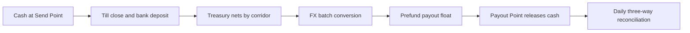

# 1. Executive overview

## 1.1 The business in brief

**Bantaba** is a remittance company. It lets families abroad send money home to West Africa by handing cash to a Bantaba staff member or authorised agent at a **Send Point**. The system issues a one-time **Bantaba Code**. The family at home redeems the code for cash, and later for wallet or bank credit, at any **Payout Point**. The moment it is redeemed, the code is nullified and can never be used again.

This plan sets out how Bantaba will build, license, launch and scale the service over five years, starting with the UK to Gambia corridor and extending to China, the USA, Senegal, Guinea and Guinea-Bissau. It is written for the founders, the board, prospective investors and the leadership team who will execute it. It draws its numbers from the Financial Plan (BNT-STR-10) and the Financial Model (`Bantaba_Financial_Model.xlsx`), and its market view from BNT-STR-07.

## 1.2 Positioning

Bantaba is **not** a fintech, neo-bank, payments platform or digital wallet. It is a remittance company with a technology backbone, **Bantaba Core**, that serves staff and compliance rather than being the customer-facing product in Phase 1. The competitive advantage is trust, people, premises, a licensed cash network and compliance discipline. The brand name comes from the *bantaba*, the shaded community meeting place at the heart of Mandinka and Senegambian villages where news, money decisions and family obligations are discussed. The tagline is **"Home, within reach."** The product line is **"Cash in. Code out. Family paid."**

## 1.3 Plan at a glance

| Item | Plan |
|---|---|
| Funding | Seed US$4.0M (close = M1, 24-month runway); Series A US$5.0M (target close M22); total US$9.0M |
| Beachhead | UK to Gambia: closed pilot M9 to M10; public beta M11 |
| Later corridors | China M15 (gated by PRC legal opinion); USA M19; Senegal M25; Guinea M31; Guinea-Bissau M31 |
| Pricing | Flat fee by band plus 1.5% FX margin (1.2% GMD to XOF, 2.0% GMD to GNF); all-in target 3 to 4.5% |
| Year 5 | US$187.5M volume; US$7.17M revenue; US$0.25M EBITDA; 56 staff; about 123,458 active senders |
| First EBITDA-positive month | M34 |
| Operating breakeven | About US$11.6M monthly volume |
| Cumulative EBITDA trough | -US$3.0M |

# 2. Mission, vision and values

**Mission.** To make sending money home feel as safe and as clear as handing it over in person, at about half the market cost.

**Vision.** To be the trusted family-support money transfer service between the Gambian, Senegambian and Guinean diaspora and their families, with a dense, licensed network of Send Points and Payout Points on both sides.

**Values and brand pillars.**

| Pillar | What it means in practice |
|---|---|
| **Transparent** | Fee, rate and receive amount are shown before the sender pays; "the rate you see is the rate they get"; no hidden fees |
| **Rooted** | Staff speak the language, agents are neighbours, community associations are partners; greetings in Mandinka, Wolof and Pulaar |
| **Fast** | Home in minutes; counter redemption target under 10 minutes |
| **Safe** | Single-use code, two channels, ID checks, four-eyes on exceptions, an immutable audit trail |

# 3. The problem and the opportunity

## 3.1 The scale of dependence

The Central Bank of The Gambia reports formal remittance inflows of **US$872.05 million in 2025**, an increase of US$54.4 million over 2024, equal to **more than 30% of GDP**. In 2024 inflows were US$775.6 million, about 31.5% of GDP, according to the CBG Governor. These are formal channels only. Informal channels, including traders, travellers and drivers, add to the total but are not captured here. Remittances are the household budget for a large share of Gambian families: food, rent, school fees, medical care, ceremonies and the building of family compounds.

## 3.2 The cost of sending

World Bank *Remittance Prices Worldwide* data put the global average cost of sending about US$200 at roughly 6 to 7% and Sub-Saharan Africa at about 8% (verify latest quarter). The UN Sustainable Development Goal target is 3%. At the scale of Gambian inflows, a three-point difference in cost is worth tens of millions of dollars a year to families. Part of the price is a visible fee; part is concealed in the exchange rate. Customers rarely know the total until the money arrives.

## 3.3 What existing options miss

| Customer need | Gap in existing options |
|---|---|
| Hand cash to a trusted person | App-first services assume a bank account, a smartphone and comfort with digital onboarding |
| Know what the family will receive | Fees and rates are shown separately or after choosing a provider |
| Give the family a safe, simple way to collect | Reference-number pickup can be intercepted or misused, and disputes are hard to settle |
| Reach a payout point near the family | Large operators have wide networks but variable service and high price; some small operators have thin networks |
| Feel protected from scams | Customers want a premises, a receipt and a person to hold accountable |

## 3.4 The opportunity

If Bantaba captures a defensible share of the corridors it serves by offering a lower all-in price with a trusted cash experience, it can build a business of about US$187.5 million of annual volume in Year 5. This is deliberately cautious. The Base case implies Gambia-bound volume of about 10.4% of formal inflows by Year 4, which is itself a stretch; the Conservative case gives 6.2%.

# 4. The product and service

## 4.1 Product suite

| Name | What it is | Phase |
|---|---|---|
| **Bantaba Send** | Consumer service: send cash at a Send Point and get a Bantaba Code; later also via app or WhatsApp with card or open-banking pay-in | P1 counter; P2 app |
| **Bantaba Points** | Network of Send Points and Payout Points, company-owned and authorised agents | P1 |
| **Bantaba Agents** | Agent programme: onboarding, float, commission, training | P1 |
| **Bantaba Code** | Single-use redemption code, the core innovation | P1 |
| **Bantaba Core** | Internal platform: staff console, quote and FX engine, ledger, code service, compliance, treasury and reporting | P1 |
| **Bantaba Business** | Bulk payouts for employers, NGOs and associations | P3 |

## 4.2 Customer journey: cash in

1. The sender walks into a Send Point with ID.
2. The cashier opens "New Transfer", selects the corridor and amount, and the system shows **You send, Fee, Rate, They receive, Total to pay**. The rate is locked for 30 minutes.
3. The cashier registers the sender and the system tiers them (T1, T2 or T3) and checks limits. ID is verified every time; there are no anonymous transfers.
4. The cashier enters the recipient (full name as on ID, phone, country and city, relationship, purpose, and source of funds where the tier requires it).
5. The system screens sender and recipient for sanctions and PEPs and applies velocity, structuring and many-to-one rules. A match places the transfer on **HELD_COMPLIANCE** and no code is released until a Compliance Officer clears it.
6. The sender hands over cash. The cashier counts, confirms receipt of the send amount plus fee, and the till is credited in the ledger.
7. The system issues the Bantaba Code (shown once on screen, printed on the receipt and sent by SMS or WhatsApp to the sender). Staff cannot retrieve it later. The sender may set a 4-digit Secret PIN.
8. The sender gives the code to the family. The recipient receives a notification from Bantaba with no code in it.

## 4.3 Customer journey: redemption

1. The recipient visits any Payout Point with ID and the code.
2. The Payout Officer enters the code in "Redeem". The system looks it up by digest, shows a masked summary and starts a 10-minute redemption session.
3. A 6-digit OTP is sent to the recipient's registered phone, independently of the sender's channel.
4. The officer checks that the ID name matches the declared recipient (fuzzy match of at least 0.80), records ID type and last four digits and, in Bands B and C, captures an ID photo. The recipient provides the OTP and the PIN if one was set.
5. **Release bands** (USD-equivalent at redemption): Band A up to US$200 needs code, OTP and ID name check; Band B from US$200.01 to US$2,000 adds an ID photo; Band C above US$2,000 adds supervisor co-approval and Compliance notification.
6. The system performs the **atomic burn**, moving the transfer from AVAILABLE to REDEEMED and the code from ACTIVE to BURNED in a single conditional write, posting the ledger journal in the same transaction, debiting the agent float and accruing commission. The officer hands over cash and a receipt is produced.
7. After the burn the code is dead. Any later attempt returns "already redeemed" and raises an alert if made at a different point or officer.

Payout is online-only. If the internet is down, the supervisor phones the Ops Desk for a voice-verified remote redemption.

## 4.4 Cancel, refund, reissue and expiry

| Event | Rule |
|---|---|
| Cancel before redemption | Sender returns to the origin point with ID and receipt; supervisor approves (four eyes); code becomes VOID; principal refunded in cash; fee refunded only for Bantaba fault or within the 30-minute cancel window |
| Lost or stolen code | Sender ID and receipt; supervisor approval; old code becomes REPLACED and a new code is issued; maximum two reissues; alert if a reissue follows a failed redemption |
| Expiry | Code valid 30 days, one 30-day extension by a supervisor; then EXPIRED and the principal moves to Unclaimed Funds; sender may claim a refund (fee retained) within 12 months; dormant-funds rules apply afterwards |
| Lock | Three failed second-factor attempts lock the transfer; supervisor and Compliance review it |
| Officer guard | Five failed code lookups in 10 minutes by one officer or point locks that session and alerts |

## 4.5 Sender KYC tiers and limits

| Tier | Requirements | Per transfer | 30 days | 12 months |
|---|---|---|---|---|
| **T1 Basic** | Government photo ID verified by staff plus scan, name, date of birth, address, phone; sanctions and PEP screen | US$400 | US$1,500 | n/a |
| **T2 Standard** | T1 plus proof of address, purpose and relationship | US$2,500 | US$7,500 | US$30,000 |
| **T3 Enhanced** | T2 plus source of funds or wealth evidence; supervisor and Compliance sign-off above US$5,000 | US$10,000 | MLRO-set (default US$25,000) | MLRO-set |

Local law may be stricter, for example US recordkeeping and travel rule requirements at US$3,000 and above, currency transaction reporting above US$10,000, UK and EU thresholds and PRC rules for outbound transfers. **The stricter local rule prevails.**

# 5. The Bantaba Code and security

## 5.1 Specification

| Item | Specification |
|---|---|
| Format | 12 characters shown `XXXX-XXXX-XXXX`, Crockford Base32 (no I, L, O or U); 11 random characters (55 bits) from a CSPRNG plus one check character |
| Transfer Reference | `BNT-` plus 8 characters; safe to share; cannot redeem |
| Storage | Only an HMAC-SHA256 digest with a server-side pepper held in an HSM or KMS; plain code exists only in memory at issue |
| Delivery | To the sender only; the recipient receives a notification without the code |
| Recipient OTP | 6 digits, 10-minute life, 3 attempts, stored as a salted hash |
| Secret PIN | Optional 4 digits set at the counter; recommended above US$500 |
| Validity | 30 days (plus 30 by a supervisor); rate lock 30 minutes |

## 5.2 Why it is secure

The design principle is that a bearer code alone is never enough. Release needs the code, which arrives through the sender; an OTP, which arrives through Bantaba to the recipient's own phone; human ID verification; and an optional PIN. The 2^55 code space means the chance that a random guess hits one of N live codes is N divided by 2^55; per-officer lockouts, global rate limits and the need for second factors even with a valid code make guessing impractical. Separation of duties is enforced: the creator of a transfer is not the approver of a cancel or reissue; a Payout Officer cannot create transfers; a Cashier cannot redeem; supervisors cannot see plain codes; administrators cannot read codes, only digests.

## 5.3 Platform controls

Bantaba Core uses TLS 1.3 externally and mutual TLS between services, AES-256-GCM at rest with envelope encryption, field-level tokenisation of PII, HSM and KMS-held keys, OAuth2 and OIDC with mandatory MFA for staff, device binding, role-based and attribute-based access, a hash-chained append-only audit log on write-once storage, ledger tables that deny update and delete, and an external penetration test before launch and annually. The standards path is FATF R.16, ISO 27001 and SOC 2 Type II by month 18. Detail is in BNT-TEC-05.

# 6. Markets and corridors

Full analysis is in BNT-STR-07. This section summarises the corridors and how they sequence.

| # | Corridor | Currencies | Launch (M1 = funding close) | Key gate |
|---|---|---|---|---|
| 1 | UK to Gambia | GBP to GMD | M11 public beta (closed pilot M9 to M10) | FCA partner route; CBG status |
| 2 | China to Gambia | CNY to GMD | M15, **gated by PRC legal opinion** | Lawful China-side structure |
| 3 | USA to Gambia | USD to GMD | M19 | FinCEN MSB and state licences or delegate model |
| 4 | Senegal and Gambia | XOF and GMD | M25 | WAEMU partner |
| 5 | Guinea and Gambia | GNF and GMD | M31 | Licensed partner; thin liquidity |
| 6 | Guinea-Bissau and Gambia | XOF and GMD | M31 | WAEMU partner |

**Phase 1 "Beachhead" (M0 to M12)** is UK to Gambia with China pilot preparation. **Phase 2 "Three hubs" (M12 to M24)** adds China and USA and launches the Bantaba Send app and wallet payout. **Phase 3 "Senegambia and Guinea" (M24 to M42)** adds regional corridors, Bantaba Business and onward routing.

The UK is the beachhead because the UK is the best-understood send market for the team and community, the licensing route through a partner is established, and the corridor has a long track record of diaspora remittances. China follows because traders and students in Guangzhou and Yiwu create strong demand, but it carries a distinct legal risk. The USA is large, with a substantial diaspora, but its licensing demands are heavy. The regional corridors extend the Gambia hub to neighbouring Dakar, Conakry and Bissau, where informal trade flows and family ties are significant.

## 6.1 Market share logic

The plan does not assume a share of global remittances. It assumes a limited share of the Gambia formal inflow, plus regional corridors. Gambia-bound volume implies about 10.4% of formal inflows by Year 4 in the Base case and 6.2% in the Conservative case. This is the most important check on plan realism: a volume projection that implied 40% of inflows, as the digital-first input blueprint's £350 million Year 3 figure would have, is not credible, and the plan was reduced for that reason (see section 18).

# 7. Customers

## 7.1 Sender persona

| Attribute | Description |
|---|---|
| Age | 28 to 55 |
| Location | UK, USA or China; Gambian, Senegambian or Guinean diaspora |
| Work | Care and NHS, logistics, hospitality, cleaning; students; traders and importers in Guangzhou and Yiwu |
| Behaviour | Sends US$100 to US$500 about twice a month for family support, school fees, rent and medical costs |
| Needs | Price clarity, a trusted counter, a receipt, certainty the family can collect |
| Channels they trust | Community associations (kafos), student societies, faith groups, family WhatsApp groups |

## 7.2 Recipient persona

Aged 25 to 65, family at home with a phone or feature phone and a Payout Point within reach. They value certainty about where to go and what to carry, respectful service in their language, a short wait and no disputes. Their SMS notification names the sender, the amount, the reference and the nearest Payout Points.

## 7.3 Agent persona

A shop owner, trader or small business in the destination country who wants a dependable commission, foot traffic and standing in the community. Agents range from sub-agent kiosks to super-agent hubs.

# 8. Competition and positioning

Competitors are described by category; full discussion in BNT-STR-07.

| Category | Strengths | Weaknesses for our target |
|---|---|---|
| Global money transfer operators | Wide payout networks, brand recognition, cash pickup | Higher all-in cost; fee and rate presentation can obscure total; variable service |
| Digital remitters and apps | Low fees, speed, good UX for banked smartphone users | Need bank account or card and onboarding; less suited to cash-based senders; limited cash pickup depth in some corridors |
| Mobile-money operators | Wide use at home; low cost for wallet-to-wallet | Require the sender to be on a linked service; cash-in at sender side is limited |
| Banks | Trust, compliance | Slow, costly, require accounts, poor reach for rural recipients |
| Informal channels | Personal, flexible, fast | Unregulated, unprotected, exposed to loss and sanctions risk |

**Bantaba's position.** The trusted cash counter on both sides, at roughly half the market all-in cost, with a verified redemption design that protects family and agent. It is not trying to outspend digital remitters on paid acquisition. It competes in the segment where a human face and a clear receipt count.

# 9. Pricing and revenue model

## 9.1 Principles

**"What you see is what they get."** Fee, rate and receive amount are shown before the sender pays. The customer rate is mid-market multiplied by one minus the margin.

## 9.2 Flat fees by send amount band (upper bound of each band)

| Currency | Band 1 | Band 2 | Band 3 | Band 4 | Band 5 |
|---|---|---|---|---|---|
| GBP | up to 50: 3.49 | up to 200: 4.99 | up to 500: 7.99 | up to 2,000: 11.99 | up to 8,000: 24.99 |
| USD | up to 60: 3.99 | up to 250: 5.99 | up to 600: 8.99 | up to 2,500: 14.99 | up to 10,000: 29.99 |
| CNY | up to 400: 29 | up to 1,800: 45 | up to 4,300: 69 | up to 18,000: 109 | up to 72,000: 219 |

Fee schedules for GMD, XOF and GNF are in the pricing configuration and BNT-OPS-01.

## 9.3 FX margin

| Corridor | Margin over mid-market |
|---|---|
| UK, China and USA to Gambia; XOF and GNF to GMD | 1.5% |
| GMD to XOF | 1.2% |
| GMD to GNF | 2.0% (thin liquidity) |

A loyalty reduction of 0.3% applies in Phase 2 to senders of US$1,500 or more a month. The **first transfer is fee-free** in Phase 1, with a waiver of up to US$6, as a customer-acquisition investment. The rate is locked for 30 minutes at no charge.

## 9.4 Worked example

A £200 cash transfer in London: fee £4.99; sender pays £204.99; illustrative mid GBP to GMD 93.42; customer rate 92.02; the recipient receives GMD 18,404. All-in cost is about 4.0% against a market of 6 to 8%. FX rates in the plan are placeholders and live feeds replace them.

## 9.5 Revenue composition

Blended take rate of about 3.8 to 4.0% of volume: a fee of about 2.4% plus FX of about 1.5%. Revenue is recognised on completed transfers. Float and unclaimed funds are not counted as revenue. Phase 3 adds Bantaba Business revenue from bulk payouts under separate pricing.

# 10. Go-to-market

## 10.1 Targets and channels

| Channel | Share of acquisition | How it works |
|---|---|---|
| Community associations, kafos, student societies, faith groups | 35% | Presence at events; trusted introducers; group sending days |
| Referral loop | 30% | "Give $10, get $10" |
| Employer and sector partnerships | 10% | Care providers, logistics firms, universities |
| Social and creator | 15% | TikTok, WhatsApp status, local languages |
| Paid | up to 10% | Only when CAC is below US$22 and payback under 9 months |

## 10.2 Messaging

"The rate you see is the rate they get." "Home in minutes." "Your family's agent is on the app or in the village." "Cash in. Code out. Family paid." The voice is warm, direct, plain English with Mandinka, Wolof and Pulaar greetings. No jargon and no "hidden fees". Detail is in BNT-STR-08.

## 10.3 Customer acquisition economics

UK to Gambia CAC is US$22. Contribution per transfer is US$5.47 and a typical sender makes nine transfers a year, so annual contribution is about US$49 and three-year lifetime value US$107. LTV to CAC is 4.9 times and payback comes after about four transfers. The first-transfer fee waiver (up to US$6) is part of the CAC investment.

## 10.4 Expansion gates

A new corridor launches only when all of these hold: payout partner SLA of at least 99.5%; licence or partner-licence coverage confirmed; at least 12 months of positive contribution margin on the previous corridor; fraud or chargeback below 0.15% of volume.

# 11. Operations and network

## 11.1 Points and agents

Points are Send, Payout or Both, and Owned or Agent-operated. Every point has a till, and payout points have a float account.

| Agent tier | Daily payout cap | Security deposit | Commission |
|---|---|---|---|
| Sub-agent (kiosk) | US$700 | US$400 | 0.6% |
| Agent | US$4,000 | US$2,000 | 0.8% |
| Super-agent (hub) | US$20,000 | US$10,000 | 0.9% plus 0.15% override on sub-agent volume |

The blended payout commission in the model is 0.70% of volume. Commission accrues at payout, is settled weekly and is subject to clawback for fraud.

## 11.2 Float model

Bantaba **funds** the payout float; the advance held at the Payout Point is a company asset. Each redemption debits float in real time and payout is blocked if float is below the payout amount. Agents also post a refundable security deposit. The target float is 2.5 days of forecast payout volume, including settlement cover, with amber alerts below 40% of target, red below 20% and prompts to sweep excess above 150%. Year-end float requirement in the Base case is US$0.07M in Year 1, US$0.64M in Year 2, US$1.19M in Year 3, US$1.43M in Year 4 and US$1.53M in Year 5.

## 11.3 Agent onboarding and control

Discovery, KYB and KYC with sanctions, PEP and adverse media checks, premises inspection and references; agreement; training and certification (two-hour AML-for-agents course, 85% pass, annual recertification); activation with deposit, test transfers and geo-fence; and a 30-day probation with lowered limits. Controls: release only when the device is within 150 metres of the registered point; device binding; daily caps; quarterly mystery-shopper audits.

## 11.4 Counter standards

Two staff on shift for four-eyes on cash, one supervisor per point, CCTV, safe, panic button, a cash cap per till (for example US$3,000 in the UK and USA, CNY 20,000 in China, GMD 150,000), a drop safe and a bank run schedule.

## 11.5 Money behind the scenes

Cash collected at Send Points is banked after till close. Treasury nets receipts against obligations by corridor, converts FX in batches and pre-funds payout float with partners and points in the destination country. A daily three-way reconciliation compares the internal ledger, bank and partner statements and till counts. Procedures are in BNT-OPS-04 and BNT-OPS-05.

# 12. Technology

## 12.1 Principles

Bounded contexts; the ledger is the source of truth for money; saga orchestration for the transfer lifecycle; transactional outbox and idempotency everywhere; ports and adapters for partners; start as a modular monolith and extract Ledger, Payout and FX services at proven seams.

## 12.2 Stack and services

TypeScript (NestJS) for product services and Go for ledger, code and payout hot paths; PostgreSQL 16; Redis; Kafka; Temporal; AWS with London as the primary region and Ireland for disaster recovery; Terraform and EKS; a React and Next.js staff console and recipient tracker as a PWA; a React Native Bantaba Send app in Phase 2. Services: Identity and Auth, KYC and Compliance, Send Point (Intake and Quote), Code Service, Core Orchestrator, FX Engine, Ledger, Payout and Agent, Risk and Fraud, Notification, Reporting and Reconciliation, and Treasury.

## 12.3 Service levels

API availability 99.95%; quote P95 under 300 ms; transfer creation P95 under 600 ms; redemption lookup P95 under 400 ms; ledger post P99 under 100 ms. Disaster recovery: RPO of 5 minutes or less and RTO of 60 minutes or less.

## 12.4 Roadmap

| Stage | Months | Content |
|---|---|---|
| Phase 0 Foundations | M0 to M3 | Entities, licensing path, partner term sheets, compliance programme, architecture decisions, design system, user research |
| Phase 1 MVP build | M2 to M7 | Ten two-week sprints: foundations and auth; ledger v1; KYC and screening; FX and quote; cash-in and orchestrator; code service and payout core; staff console v1, risk rules and alpha; refunds, cancel, reissue, disputes and reconciliation; agent and payout app, float and geo-fence; back-office consoles, reporting, hardening and load tests |
| Phase 2 Security audit and readiness | M7 to M8 | External penetration test and readiness review |
| Phase 3 Closed pilot | M9 to M10 | 200 invited senders, 20 points, US$65,000 volume cap, US$400 per transfer |
| Phase 4 Public beta | M11 to M12 | Open to the public in the UK corridor |
| Phase 5 Full launch and scale | M12 onward | Add corridors per gates |
| Product Phase 2 | M13 to M24 | Bantaba Send app, WhatsApp ordering, wallet and bank payout, USSD tracker |
| Product Phase 3 | M25 onward | Business API, onward routing |

# 13. Compliance and licensing

This section is a structural map, **not legal advice**; counsel will confirm each jurisdiction. Bantaba does not claim any licence as held; all are "planned", "to be obtained" or "target". See BNT-CMP-01 for the full roadmap.

| Jurisdiction | Plan |
|---|---|
| **UK (send)** | Money remittance is a payment service under the Payment Services Regulations 2017. Launch through an FCA-authorised payment institution partner or agent arrangement while preparing Bantaba's own authorised payment institution application (typically 9 to 12 months, verify). MLRs 2017 apply: MLRO, risk assessment, customer due diligence; SARs to the NCA; sanctions through OFSI. The FCA's tightened safeguarding rules took effect on 7 May 2026 (daily reconciliation, resolution packs, annual safeguarding audit above £100,000 average relevant funds, monthly returns, director oversight); counsel must confirm how they apply to a remittance-only firm. UK GDPR and DPA 2018 apply |
| **USA (send)** | FinCEN MSB registration plus state money-transmitter licences, or operate as authorised delegate of a licensed operator. BSA and AML programme, SAR, CTR for cash above US$10,000, funds-transfer recordkeeping and travel rule at US$3,000 and above, OFAC. CFPB Remittance Rule (Regulation E subpart B): pre-payment disclosure, receipt, 30-minute cancellation right and error resolution, subject to counsel |
| **China (send)** | **Caution and gating item.** Outbound cross-border funds movement is tightly controlled (SAFE; annual individual FX quota of US$50,000 for Chinese citizens; regulation effective 1 January 2026 tightening remitter KYC for single outbound transfers above RMB 5,000, about US$1,000, and extending record retention from 5 to 10 years). **Unlicensed cash collection and offsetting settlement across borders is a criminal offence in the PRC.** Bantaba will not collect cash in mainland China or settle against it except through a structure validated by PRC counsel and permitted by regulators. Options: a Hong Kong entity with a Money Service Operator licence; a licensed cross-border payment institution or bank partner as the China-side rail; or a trade-settlement model run by a licensed partner. The corridor launches only after a written PRC legal opinion, planned for M15 and conditional |
| **Gambia (receive)** | Central Bank of The Gambia oversight; operate through CBG-authorised money transfer or payment service provider status, directly or via a licensed partner; payout through licensed banks, mobile-money operators (Wave, Afrimoney, QMoney) and own Payout Points; AML/CFT Act 2012 (a replacement bill validated in 2024, status to confirm); STRs to the FIU; GIABA oversight |
| **Senegal and Guinea-Bissau** | BCEAO regulates; money transfer needs approval or sub-agent status; Instruction n°09/07/2025/RFE (effective 1 August 2025) on external financial relations; transfers below XOF 1,000,000 generally need no specific supporting documents subject to AML. Partner-first |
| **Guinea** | BCRG rules; partner-first with a licensed institution |

Governance includes a board-approved AML policy and risk appetite, MLROs for the UK and The Gambia, an annual enterprise-wide risk assessment, an independent annual AML audit, staff training with annual attestation, and three lines of defence. Monitoring rules include limits on transfer counts, structuring (three or more transfers within 72 hours each at or above 90% of the per-transfer limit), many-to-one (a recipient receiving from more than six unrelated senders in seven days) and one-to-many (one sender to more than five recipients in seven days). Screening: a fuzzy match of 92 or above auto-holds; 80 to 91 goes to an analyst queue; below 80 passes and is logged. Four-eyes review is completed within four business hours. Records are retained for at least five years (PRC rules may require 10 for outbound records).

# 14. Organisation and governance

## 14.1 Entities (working names, to be incorporated)

| Entity | Role |
|---|---|
| Bantaba Remittance Holdings Ltd (UK) | Parent |
| Bantaba Remittance UK Ltd | Operating, regulated; FCA path |
| Bantaba Remittance (Gambia) Ltd | CBG licence path |
| Bantaba Remittance USA Inc (Delaware) | MSB and state licences |
| Bantaba Hong Kong Ltd | MSO path, China-linked structure, subject to legal opinion |
| Senegal, Guinea-Bissau, Guinea | Via partners at first |

## 14.2 People

| Year-end | Y1 | Y2 | Y3 | Y4 | Y5 |
|---|---|---|---|---|---|
| Headcount | 18 | 32 | 45 | 53 | 56 |

Functions: executive and leadership (CEO, COO, CTO, CFO and Treasury head, MLRO and Head of Compliance); engineering and product; compliance and risk; treasury and finance; HQ operations and customer support; Send Point staff in the UK, China and USA; payout and agent team in The Gambia and region; growth and community. Role descriptions are in BNT-OPS-10 and training in BNT-OPS-11.

## 14.3 Governance

A board with investor directors and an independent director; an audit and risk committee; a monthly AML and compliance committee; and a weekly treasury committee in an ALCO style. All privileged changes (fees, limits, spreads, rules, roles) need four-eyes approval. MFA is mandatory for all staff and all actions are audited with a hash-chained, append-only log.

## 14.4 Roles and separation of duties

| Role | Can | Cannot |
|---|---|---|
| Cashier | Create quotes and transfers, register senders, print receipts | Redeem; cancel or reissue without a supervisor; see codes after issue; change rates or limits |
| Payout Officer | Look up and redeem, capture OTP and ID | Create transfers; cancel; change rates |
| Supervisor | Approve cancel, reissue and extension; co-approve Band C; close till | Change FX rules; clear compliance holds |
| Compliance Officer | Review alerts and holds; file SAR and STR; manage watchlists | Move money; change fees |
| Treasury Officer | Set FX mids and spreads with four-eyes; approve float top-ups | Clear compliance alerts |
| Operations Desk | Remote redemption in an outage; support | Change rates |
| Admin | Manage users and configuration; view audit log | Handle money; read codes |
| Auditor | Read-only | Write anything |

# 15. Phasing and milestones

| Window | Milestones |
|---|---|
| M1 to M3 | Seed closed; entities set up; counsel instructed in UK, Gambia, USA and PRC or Hong Kong; partner term sheets; compliance programme drafted; leadership hires |
| M2 to M7 | Build Bantaba Core in ten sprints; recruit Send Point and Payout teams; agent pipeline in The Gambia |
| M7 to M8 | Security audit and readiness; UK route confirmed; CBG status confirmed |
| M9 to M10 | Closed pilot: 200 invited senders, 20 points, US$65,000 cap, US$400 per transfer |
| M11 to M12 | UK public beta; first fee-free transfers; community partnerships |
| M13 to M15 | Series A preparation begins about M15; China opinion planned M15 |
| M15 to M19 | China (if gated condition met) and USA launches; Bantaba Send app |
| M22 | Series A closing target |
| M25 to M31 | Senegal at M25; Guinea and Guinea-Bissau at M31 |
| M34 | First EBITDA-positive month (Base case) |
| M42 | Phase 3 complete; Bantaba Business and onward routing |

# 16. Financial plan

Full detail is in BNT-STR-10 and `Bantaba_Financial_Model.xlsx`. All figures are US$, Base case and planning grade.

## 16.1 Five-year summary

| | Y1 | Y2 | Y3 | Y4 | Y5 |
|---|---|---|---|---|---|
| Transfers | 5,130 | 179,229 | 528,263 | 825,181 | 943,399 |
| **Volume sent** | **$1.18M** | **$46.4M** | **$120.7M** | **$168.8M** | **$187.5M** |
| **Revenue** | $0.05M | $1.79M | $4.59M | $6.44M | $7.17M |
| Variable costs | $0.02M | $0.75M | $1.96M | $2.73M | $3.04M |
| **Contribution** | $0.03M | $1.04M | $2.64M | $3.71M | $4.13M |
| Fixed costs | $1.34M | $2.26M | $3.04M | $3.59M | $3.88M |
| **EBITDA** | **-$1.31M** | **-$1.22M** | **-$0.40M** | **+$0.12M** | **+$0.25M** |
| Year-end headcount | 18 | 32 | 45 | 53 | 56 |
| Active senders (year-end) | 4,708 | 38,421 | 89,330 | 114,280 | 123,458 |
| Float required (year-end, 2.5 days) | $0.07M | $0.64M | $1.19M | $1.43M | $1.53M |

## 16.2 Volume by corridor (US$M)

| Corridor | Y1 | Y2 | Y3 | Y4 | Y5 |
|---|---|---|---|---|---|
| UK to Gambia | 1.2 | 27.1 | 45.0 | 51.6 | 54.0 |
| China to Gambia | 0 | 14.8 | 37.0 | 45.3 | 48.4 |
| USA to Gambia | 0 | 4.5 | 22.9 | 31.3 | 34.4 |
| Senegal | 0 | 0 | 12.6 | 24.8 | 29.2 |
| Guinea | 0 | 0 | 2.0 | 9.9 | 13.6 |
| Guinea-Bissau | 0 | 0 | 1.2 | 5.9 | 8.0 |

## 16.3 Key metrics

Blended take rate 3.8 to 4.0%; contribution about 2.2 to 2.3% of volume; first EBITDA-positive month M34; operating breakeven about US$11.6M monthly volume; cumulative EBITDA trough -US$3.0M; lowest month-end cash US$0.80M just before the Series A; Gambia-bound volume about 10.4% of formal inflows by Year 4 (stretch; Conservative 6.2%).

## 16.4 Unit economics, UK to Gambia

| Metric | Value |
|---|---|
| Average ticket | US$230 |
| Revenue per transfer | US$9.20 (4.0%) |
| Variable cost per transfer | US$3.73 |
| Contribution per transfer | US$5.47 |
| Transfers per year | 9; contribution about US$49 a year |
| 3-year LTV | US$107 |
| CAC | US$22 |
| LTV to CAC | 4.9x; payback about 4 transfers |

Variable costs, as percentages of volume: payout commission 0.70; origin commission 0.25; banking, settlement and FX 0.30; fraud and loss 0.10; KYC, screening and SMS 0.12; cash logistics and insurance 0.15; total **1.62%**.

## 16.5 Scenarios

| Scenario | Volume multiplier | Result |
|---|---|---|
| Base | 1.0x | As above |
| Conservative | 0.6x | Year 3 volume US$72M; EBITDA about -US$1.4M a year; no breakeven in five years; lowest cash -US$0.44M, so a bridge or leaner plan is needed |
| Upside | 1.3x | Year 3 volume US$157M; first EBITDA-positive month at M24 |

## 16.6 Why the early years are thin

The early economics are thin by design. Year 1 is build, licensing, the closed pilot and the beginning of a public beta; revenue is US$0.05 million against fixed costs of US$1.34 million. Year 2 adds China and USA volume but is still loss-making because the network, compliance and engineering teams are being built ahead of volume. EBITDA turns positive in Year 4. Investors should read the plan as a build-then-harvest profile: the business needs its second funding round and a dense network before the contribution of about 2.2 to 2.3% of volume covers fixed costs.

# 17. Funding

## 17.1 Rounds

**Seed US$4.0 million** (24-month runway; closes at M1) and **Series A US$5.0 million** (target close M22; process opens about M15). Total plan US$9.0 million.

## 17.2 Seed use of funds

| Use | US$M | Share |
|---|---|---|
| Product and engineering (Bantaba Core, security audit, apps) | 1.2 | 30% |
| Licensing, legal and compliance | 0.8 | 20% |
| Operations, Send Points and agent network | 0.9 | 22.5% |
| Leadership, finance and G&A | 0.5 | 12.5% |
| Marketing and community | 0.2 | 5% |
| Prefunded float and working capital | 0.4 | 10% |
| **Total** | **4.0** | **100%** |

## 17.3 Series A triggers

At least US$5 million of monthly run-rate volume; two corridors live; fraud below 0.1% of volume; licences secured for UK send and Gambia receive.

## 17.4 Cash risk

The lowest month-end cash in the Base case is US$0.80 million, immediately before the Series A. This leaves limited headroom. In the Conservative case the minimum is negative at -US$0.44 million, so the company would need a bridge, a delay of non-core spending or a leaner plan. Management's contingency levers are set out in BNT-STR-10 and BNT-STR-11.

# 18. Key departures from the input blueprints

| # | Departure |
|---|---|
| 1 | **Cash-first, not digital-first.** Phase 1 revenue comes from staffed Send Points; app, card and open-banking pay-in and wallet payout arrive in Phase 2 |
| 2 | **Redemption code replaces pickup OTP and reference** |
| 3 | **Remittance company, not fintech** |
| 4 | **Pricing** of 3 to 4.5% all-in, above the Blueprint's 2 to 2.5% digital all-in because cash costs more, yet about half the 6 to 8% market average |
| 5 | **Volume plan reduced** to a defensible share of Gambia inflows |
| 6 | **Float model clarified**: company-funded float plus agent security deposit |
| 7 | **China corridor gated** by PRC legal opinion |
| 8 | **Online-only release** at Payout Points |
| 9 | **USD-equivalent limits** across corridors |

**Honesty note.** The Blueprint's digital-first projection of £350 million volume by Year 3 would equal about 40% of Gambia's total formal inflows. The cash-first plan here is deliberately more conservative: about 10% of Gambia inflows by Year 4, plus regional corridors.

# 19. Risks and mitigations

The full register is BNT-STR-11. Principal risks are below.

| Risk | Likelihood and impact | Mitigation |
|---|---|---|
| UK licensing or partner delay | Medium; high | Partner-first route; counsel-led roadmap; pilot cannot start without confirmed position |
| CBG authorisation timing | Medium; high | Licensed payout partners first; own authorisation in parallel |
| China structure not available | Medium; high | Corridor gated; no China cash collection before written opinion; HK and licensed-partner options; plan tolerates delay |
| USA licensing cost and time | High; medium | Delegate model; state-by-state sequence; corridor after UK |
| Cash robbery, theft or till shortages | Medium; medium | Two staff, till caps, safe, CCTV, insurance, bank-run schedule, cash over and short account |
| Fraud and scams | Medium; high | Code design, OTP, ID checks, bands, velocity and structuring rules, supervised exceptions |
| Agent misconduct | Medium; medium | Deposits, caps, geo-fence, probation, mystery shoppers, clawback |
| FX and liquidity (GNF, GMD) | Medium; medium | Batch conversion, Treasury spreads under four-eyes, wider margin on thin corridors, float cover |
| Early economics and funding | High; high | 24-month runway, Series A triggers, leaner-plan option, transparent Conservative case |
| De-risking by banks | Medium; high | Multiple banking relationships; strong compliance evidence; audit trail |
| Data protection | Low; high | Tokenisation, encryption, minimal PII, DPO, regional hosting decisions |
| Competitive response | Medium; medium | Trust, network density and price; do not compete on paid acquisition |

# 20. Key performance indicators

Targets at M12 unless stated.

| KPI | Target |
|---|---|
| Activation | Above 65% |
| Transfers per active sender per month | At least 1.4 |
| 90-day repeat | Above 60% |
| Payout time | P95 under 90 seconds (digital); under 10 minutes (counter redemption) |
| Support contacts | Fewer than 8 per 100 transfers |
| Fraud loss | Under 8 basis points |
| Screening SLA | 100% |
| Contribution per transfer | Above US$2.00 blended |
| NPS | Above 55 |

Corporate KPIs also include monthly volume against the US$5 million Series A trigger, the share of Gambia formal inflows, float utilisation, agent activation rate, till variance, and compliance alert ageing.

# 21. Long-term direction

In Year 5 the Base case reaches US$187.5 million of volume with US$0.25 million of EBITDA and positive contribution of about US$4.13 million. Subsequent options, to be tested only after core gates are met, include deeper onward routing between the six corridors, the Bantaba Business API for employers, NGOs and associations, payout into wallets and bank accounts, and partnerships with community organisations. A sale to a larger remittance operator, or a later growth round, are possibilities; no exit is promised in this plan and investors should treat returns as uncertain.

# 22. Open items / assumptions to validate

- Licensing routes and timelines in the UK, USA, The Gambia, the PRC or Hong Kong, WAEMU and Guinea require counsel confirmation; no licence is held.
- Whether and how the FCA's May 2026 safeguarding rules apply to a remittance-only firm.
- The China corridor structure and the PRC legal opinion planned for M15.
- External statistics marked "(verify)" must be refreshed before distribution.
- FX rates are illustrative placeholders (units per USD: GBP 0.76; CNY 7.10; GMD 71.0; XOF 590; GNF 8,650).
- Customer demand for cash-first service, the 4.9x LTV to CAC and the 9-transfers-a-year assumption are to be tested in the closed pilot.
- The 10.4% share of Gambia formal inflows by Year 4 depends on assumed growth of the Gambia inflow base; confirm in the model.
- Cash headroom in the Base case is limited (lowest cash US$0.80M); contingency levers to be agreed by the board.
