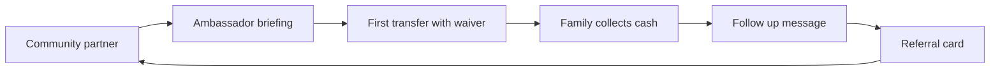

# 1. Summary

Bantaba is a **remittance company**. Its customers are families who move money between the diaspora and West Africa, and who decide who to trust through people they already know. The go-to-market strategy therefore starts in **rooms, not feeds**: community associations, kafos, student societies, faith groups, employers and families. Digital channels support that trust; they do not replace it.

The plan has five parts: who we serve (section 2), what we promise and how we sound (sections 3 and 4), how we acquire and retain customers channel by channel (sections 5 to 8), how we launch each corridor (section 9), and how we measure and govern spend (sections 10 and 11).

| Item | Position |
|---|---|
| Category | Remittance company; money transfer service; family-support money transfer |
| Tagline | "Home, within reach." |
| Product line | "Cash in. Code out. Family paid." |
| Brand pillars | Transparent, Rooted, Fast, Safe |
| Beachhead | UK to Gambia, closed pilot M9-M10, public beta M11 |
| Acquisition cost target | $22 blended for UK to Gambia; paid media only when CAC is below $22 and payback below 9 months |
| Seed marketing budget | $0.2M (5% of the $4.0M seed) |
| Acquisition mix | Community 35%, referral 30%, social and creator 15%, employer and sector 10%, paid at most 10% |

# 2. Who we serve

## 2.1 Sender persona: "Awa in Luton"

Age 28 to 55, living in the UK, the USA or China and originally from The Gambia, Senegal, Guinea or Guinea-Bissau. Occupations include care and NHS support work, logistics and warehousing, hospitality, students, and traders and importers in Guangzhou (Xiaobei) and Yiwu. Sends **$100 to $500 about twice a month** for family support, school fees, rent and medical bills. Average ticket in the model is $230 and nine transfers per year (UK to Gambia).

| Dimension | What we believe (to be tested in Phase 0 research) |
|---|---|
| Needs | Certainty that money arrived, a price she can see, a way to pay in cash, someone to call |
| Fears | Hidden fees, a wrong number, an agent saying "not yet", fraud on the family |
| Triggers | Month-end, school terms, Ramadan and Eid, Tabaski, funerals and naming ceremonies, medical emergencies |
| Influencers | Family, kafo chair, imam or pastor, workmates, WhatsApp groups, community radio |
| Barriers | Bank-account or app mistrust, lack of English-language ease, immigration anxiety about data |

## 2.2 Recipient persona: "Mama in Serrekunda"

Age 25 to 65, in a town or village with a phone (often a feature phone) and a Payout Point within reach. She values clarity: who sent it, how much, where to collect, what to bring. She is as much our customer as the sender, because her experience at the payout counter decides whether the sender stays. The recipient notification carries sender first name, amount, reference, nearest Payout Points and what to bring. It never carries the code.

## 2.3 Secondary segments

| Segment | Why | Phase |
|---|---|---|
| Student sponsors and parents paying tuition | Predictable seasonal volume | 1 |
| Small traders and importers (China, UAE-linked later) | Higher tickets, repeat, supplier payments | 2 (China gated) |
| Employers with Gambian or Senegambian staff | One conversation reaches many senders | 1 to 2 |
| Associations, village development groups, NGOs | Collective remittances | 3 (Bantaba Business) |

# 3. Positioning and proposition

## 3.1 Positioning statement

For families who support each other across borders and prefer to deal with a person they can trust, Bantaba is the remittance company that lets you hand over cash, shows you exactly what your family will receive before you pay, and gives you a one-time code that works once and then is gone. Unlike digital-only remitters we have a counter and a face at both ends; unlike traditional operators we publish an all-in price of 3 to 4.5% rather than hiding the rate.

## 3.2 Messaging pillars

| Pillar | Message | Proof point |
|---|---|---|
| Transparent | "The rate you see is the rate they get." | You send, Fee, Rate, They receive, Total to pay on screen and receipt; rate locked 30 minutes |
| Fast | "Home in minutes." | Counter redemption target under 10 minutes at P95; digital under 90 seconds |
| Rooted | "Your family's agent is on the app and in the village." | Named Payout Points; agents from the community; local-language support |
| Safe | "Cash in. Code out. Family paid." | Burn-once code; recipient OTP; ID checks; licensed partners and planned licences |

## 3.3 Price communication

A single published worked example is used everywhere (counter posters, WhatsApp status, recruitment cards):

| Line | Value |
|---|---|
| Cash handed over | GBP 200.00 |
| Transfer fee | GBP 4.99 |
| Total you pay | GBP 204.99 |
| Rate (illustrative, mid 93.42 less 1.5%) | 92.02 |
| Family receives | GMD 18,404 |
| All-in cost | about 4.0% |

All materials say "illustrative rate; the live rate is shown before you pay". We never advertise "zero fees" except the first-transfer waiver, and we never use the phrase "hidden fees" in any context other than to say we have none.

## 3.4 What we do not claim

| Do not say | Say instead |
|---|---|
| "We are licensed by the FCA" (until true) | "We operate through an FCA-authorised partner; our own application is planned" |
| "Instant" or "guaranteed" | "Typically in minutes once the code is issued" |
| "The cheapest" | "About half the average market cost; see the worked example" |
| "Fintech", "app", "neobank" | "Remittance company", "money transfer service" |
| "Bantaba Save" | Not a product; never used |

# 4. Brand

## 4.1 Name and story

A *bantaba* is the shaded community meeting place at the heart of Mandinka and Senegambian villages, under a baobab or mango tree, where news, money decisions and family duties are discussed. We use the story lightly: one sentence on the website, one on the poster, never a lecture. The brand is a meeting place for families and their money.

## 4.2 Brand pillars and personality

| Pillar | Behaviour in practice |
|---|---|
| Transparent | Prices in the first line; no small print; fees refunded plainly when we are at fault |
| Rooted | Staff who speak customers' languages; sponsorship of community events; Payout Points named by neighbourhood |
| Fast | No queue theatre: rate lock, pre-filled repeat recipients, fast ID routine |
| Safe | Visible cameras and uniforms, ID every time, no exceptions, and we say why |

Personality: warm, direct, dignified, a little humorous. We talk like a respected cousin who works in finance, not like a bank and not like a start-up.

## 4.3 Voice

| Rule | Example |
|---|---|
| Plain English, short sentences | "Bring your ID and the code. We will do the rest." |
| Greet in local languages | "Salaam aleikum." "Nanga def." "A jaraama." (Mandinka, Wolof and Pulaar greetings reviewed by native speakers) |
| Never jargon | Say "ID check", not "KYC"; "price check", not "FX spread" |
| Never hype | No "revolutionary", "disruptive", "game-changing" |
| Say what we do when things go wrong | "If the transfer is held for a check, we will tell you why and when." |

## 4.4 Visual identity ("Warm Night")

The design system is specified in BNT-DSN-01. Key marks for marketing use:

| Element | Specification |
|---|---|
| Primary colours | Baobab Green #0F7B5F; Savanna Gold #F2B138 as accent and CTA, used with Midnight Ink #0A1412 text and never gold text on white |
| Backgrounds | Warm Sand #F6F1E7 (light), Midnight Ink #0A1412 (dark) |
| Typography | Sora for headings, Inter for body (minimum 15-16 px), tabular type for amounts and codes |
| Motif | Bantaba tree and woven kente or bogolan patterns, used sparingly |
| Accessibility | WCAG 2.2 AA; never rely on colour alone |
| Languages | English and French, with Mandinka, Wolof and Pulaar snippets; Simplified Chinese strings for China Send Points (Phase 1.5) |

## 4.5 The physical brand

Because we are a counter business, the premises are the primary brand asset.

| Asset | Standard |
|---|---|
| Storefront | Baobab-green fascia, tagline, visible price board, opening hours in English and local language |
| Counter | Two-person service, price card with the worked example, ID-check notice, CCTV sign |
| Staff | Uniform with name badge and languages spoken |
| Receipt | Transfer reference (shareable), the code once, recipient pick-up instructions, helpline |
| Payout Point | Same fascia; "Bantaba Payout" sign; list of what to bring posted at the door |
| Agent point | Co-branded with Bantaba plate, ID cards for staff, training certificate displayed |

# 5. Acquisition channels

The model attributes acquisition as follows (BIBLE canon). Each channel has an owner, a repeatable unit and a measure.

| Channel | Share | Repeatable unit | Primary measure |
|---|---|---|---|
| Community associations, kafos, student societies, faith groups | 35% | One partnered association with a named ambassador | First transfers per association per month |
| Referral loop "Give $10, get $10" | 30% | One invitation code per active sender | Referred sender activation within 30 days |
| Social and creator (TikTok, WhatsApp status, local languages) | 15% | One creator or content series | Cost per activated sender |
| Employer and sector partnerships | 10% | One employer or agency | Enrolled staff who send |
| Paid | 10% maximum | One campaign | CAC below $22 and payback below 9 months |

## 5.1 Community partnerships (35%)

This is the core channel and the slowest to build, so it starts in Phase 0 (M0-M3), well before the first counter opens.

| Step | Detail | Timing |
|---|---|---|
| Map | List 80 associations in the UK catchment (Gambian, Senegambian, Guinean, student, faith) | M0-M2 |
| Meet | Founder and community lead attend meetings; listen before pitching | M1-M6 |
| Pilot partners | Sign 12 associations as "Bantaba Friends" for the closed pilot | M5-M8 |
| Ambassadors | Each partner names an ambassador; trained on the product; paid a modest stipend, or a donation to the association's cause | M6-M9 |
| Events | Counter open days, "Meet the agent from home", Q&A on pricing and safety | M8 onward |
| Return | Association receives a 0.1% community contribution on referred volume, paid as a donation, subject to compliance review | From M11 |

Rules: no political affiliation; no pressuring members; any payment to an association is documented and reviewed by Compliance to avoid inducement or conflict.

## 5.2 Referral loop (30%)

"Give $10, get $10": the referrer and the friend each receive a $10 credit (GBP, USD or CNY equivalent) applied to fees on their next transfers, after the friend's first completed transfer.

| Control | Rule |
|---|---|
| Eligibility | Friend must be a new verified sender; referrer must be KYC tier T1 or above |
| Cap | Credit applies to fees and FX only; capped at $6 per transfer against the fee; maximum 5 paid referrals per sender per quarter |
| Abuse | Same-device, same-address and same-recipient patterns reviewed by Compliance; credits void on fraud |
| Cost | Included in the $22 CAC; reviewed monthly |
| Mechanics | Phase 1: printed referral card with a code the cashier enters; Phase 2: in-app link |

## 5.3 Social and creator (15%)

Content is made by and for the community, in short video and voice notes, mainly on TikTok, WhatsApp status and Facebook (verify channel mix after Phase 0).

| Content series | Purpose |
|---|---|
| "What your family receives" | Live price walk-through on camera, one example per corridor |
| "Meet your Payout Point" | Face and place of agents in Serrekunda, Brikama, Basse, Farafenni and other towns |
| "Why we ask for ID" | Normalise ID checks as protection |
| "Scam alert" | Short educational clips on fake agents, fake SMS and fake codes (aligned with BNT-CMP-13) |
| Language clips | Greetings and short messages in Mandinka, Wolof and Pulaar |

Creators are paid through a written brief, disclosure of paid status, and an approval step by Compliance for claims. No creator may promise "guaranteed" delivery or quote a rate not drawn from the live rate card.

## 5.4 Employer and sector partnerships (10%)

Target sectors: care agencies and NHS-support employers, logistics and warehousing firms with Gambian and Senegambian staff, hospitality groups, universities with African student societies, and in China, trading companies and student associations (gated by the China opinion).

| Offer | Detail |
|---|---|
| Staff session | 30-minute lunchtime talk and counter day; no obligation |
| Payroll-day counter | Bantaba staff attend on payday (subject to licensing and safety review) |
| Employer benefit | Staff information sheet; the employer receives no commission |
| Compliance | No employer data is shared; participation is voluntary |

## 5.5 Paid (maximum 10%)

Paid media is the last lever, switched on only when the blended CAC is below $22 and payback is under nine months. Eligible formats: local radio, community press, Google and Meta lead ads in a catchment of 5 km around a Send Point, and search for corridor terms. All paid creative is approved by Compliance before use.

# 6. Funnel and conversion

| Stage | Definition | M12 target |
|---|---|---|
| Aware | Heard of Bantaba via any channel | tracked by survey |
| Visit | Enters a Send Point or opens the booking link | tracked |
| Activate | Completes first transfer and recipient collects | **>65% of registered senders** |
| Repeat | Second transfer within 90 days | **>60%** |
| Frequency | Transfers per active sender per month | **>=1.4** |
| Advocate | Refers at least one friend | 20% of active senders (target, to be validated) |

Activation is the critical metric because the free first transfer costs money only when someone is new, and the recipient experience decides repeat. The post-transfer follow-up is a single SMS or WhatsApp message to the sender: "Has your family collected? Reply 1 for yes, 2 for no." A "no" creates an Operations Desk task within one hour.

# 7. Retention and loyalty

| Lever | Mechanism | Phase |
|---|---|---|
| Rate lock | 30 minutes free, shown on receipt | 1 |
| Repeat recipient | Saved on the cashier screen after first transfer | 1 |
| Loyalty tier | 0.3% FX margin reduction for senders at or above $1,500 per month | 2 |
| Season campaigns | Ramadan, Eid, Tabaski, school terms: reminders and extended hours | 1 onward |
| Service recovery | Fee refunded when we are at fault; call-back within one working hour | 1 |
| NPS and feedback | Counter tablet or SMS 48 hours after collection; NPS target above 55 | 1 |

Retention economics: moving 90-day repeat from 50% to 60% adds roughly one more transfer per sender per year at $5.47 contribution (planning estimate), which is worth more than the same spend on new acquisition at a CAC of $22.

# 8. Recipient and payout-side marketing

Payout Points need to be known as places families can trust. Activities:

| Activity | Detail |
|---|---|
| Point launch day | Community leaders invited; staff introduced; "what to bring" card distributed |
| Local radio | Short spots in Mandinka, Wolof and Pulaar on community stations (verify costs) |
| Recipient notification | Includes nearest Payout Points and what to bring; no code, ever |
| Agent recruitment | Recruit shopkeepers, pharmacies and trusted traders; see BNT-OPS-09 |
| Anti-fraud education | "Bantaba will never ask you for the code by phone" posted in each point |

# 9. Corridor launch playbooks

## 9.1 UK to Gambia (M11 public beta)

| Period | Activity |
|---|---|
| M3-M8 | Community mapping, 12 pilot associations, 40 named ambassadors, 200 invited senders list |
| M9-M10 | Closed pilot: 200 invited senders, 20 points, $65k volume cap, $400 per transfer; weekly feedback sessions |
| M11 | Public beta: counter promotion, referral cards, first-transfer waiver, community radio |
| M12 | Review of M12 KPIs; decide paid media only if CAC is below $22 |
| M12-M24 | Expand catchments; sector partnerships; add open-banking pay-in in Phase 2 |

## 9.2 China to Gambia (M15, gated)

Launch marketing is prepared but **not published** until a written PRC legal opinion is received and the licensed structure is live. The planned channels are student societies and trader associations in Guangzhou and Yiwu, WeChat service accounts and WhatsApp (verify channel rules), Simplified Chinese materials, and Chinese-language staff. No marketing in mainland China may imply cash collection in the PRC unless the structure permits it.

## 9.3 USA to Gambia (M19)

Catchments follow diaspora concentrations (verify with Phase 0 research). The channel mix mirrors the UK, plus the Reg E disclosure and cancellation wording required by counsel; state licensing status determines which states we can serve.

## 9.4 Senegal, Guinea and Guinea-Bissau (M25 and M31)

Partner-first: marketing is co-created with the licensed partner. Language and imagery are Wolof and French for Senegal; French and local languages for Guinea; Portuguese-Creole sensitivity for Guinea-Bissau (verify). Price messaging reflects higher margins: 1.2% on GMD to XOF, 2.0% on GMD to GNF.

## 9.5 Expansion gates (all must hold)

Payout partner SLA at least 99.5%; licence or partner-licence coverage confirmed; at least 12 months of positive contribution margin on the previous corridor; fraud and chargeback below 0.15% of volume.

# 10. Budget and measurement

## 10.1 Marketing budget from the seed

The seed allocates **$0.2M** to marketing and community. The table is a planning allocation; the Head of Growth reallocates monthly against CAC.

| Item | Amount (US$) | Share |
|---|---|---|
| Community programme (events, ambassador stipends, association contributions) | 70,000 | 35% |
| Referral credits (funded as fee waivers; recorded in the ledger as marketing expense) | 45,000 | 22.5% |
| Content and creator production | 30,000 | 15% |
| Point branding and print | 25,000 | 12.5% |
| Employer and sector sessions | 10,000 | 5% |
| Paid tests (only if CAC below $22) | 10,000 | 5% |
| Research and brand testing | 10,000 | 5% |
| **Total** | **200,000** | **100%** |

Note: transfers per year in Year 1 are only 5,130, so Year 1 CAC is a small-sample estimate. After the pilot, spend is re-baselined at Series A planning.

## 10.2 Dashboard

| Metric | Target (M12) | Frequency | Owner |
|---|---|---|---|
| Activation | >65% | Weekly | Head of Growth |
| Transfers per active sender per month | >=1.4 | Monthly | Head of Growth |
| 90-day repeat | >60% | Monthly | Head of Growth |
| CAC by channel | <$22 blended | Monthly | Head of Growth and CFO |
| Payback | <9 months | Monthly | CFO |
| NPS | >55 | Monthly | Operations |
| Support contacts per 100 transfers | <8 | Weekly | Customer Support Lead |
| Contribution per transfer | >$2.00 blended | Monthly | CFO |
| Referral share of new senders | about 30% | Monthly | Head of Growth |

## 10.3 Decision rules

| Condition | Action |
|---|---|
| Channel CAC above $30 for two months | Pause and review |
| Channel CAC below $15 | Increase budget, maximum +25% per month |
| Activation below 50% at M12 | Halt expansion spend; investigate product and recipient experience |
| NPS below 40 | Service-recovery sprint before any new acquisition |

# 11. Governance, compliance of marketing and crisis communication

All promotions follow BNT-CMP-07 (Customer Terms) and BNT-CMP-11 (Complaints), and are reviewed by Compliance before use. Price claims must come from the live fee and rate tables (BIBLE section 6). Regulatory warnings required by FCA, CFPB and local rules are included in each jurisdiction.

| Crisis | First response (within 2 hours) | Owner |
|---|---|---|
| Fraud incident affecting customers | Stop transfers at affected point; notify customers; publish plain statement | CEO and COO |
| Robbery or safety incident | Staff welfare first; closure notice; no speculation | COO |
| Outage | Status message on website, WhatsApp and counter; voice-verified remote redemption | CTO and Operations Desk |
| Regulatory enquiry | Counsel and MLRO lead; no public comment beyond approved statement | MLRO |
| Social media rumour about "money not arriving" | Respond with transfer reference check; offer call-back; correct publicly | Head of Growth |

The spokesperson rule: the CEO speaks on strategy and incidents; the MLRO speaks on compliance; the Head of Growth speaks on product and community. No staff member comments on individual customers.

# 12. Open items / assumptions to validate

- Phase 0 user research (M0-M3) must validate the sender and recipient personas, channel preferences and willingness to pay in cash.
- CAC of $22 and 30% referral share are model assumptions until pilot data is available.
- Mandinka, Wolof and Pulaar copy must be reviewed by native speakers; Simplified Chinese by a qualified translator.
- Community contribution to associations (0.1% of referred volume) requires compliance and legal review in each jurisdiction.
- Social and radio channel costs are placeholders (verify).
- Marketing rules in China (WeChat, advertising law) require PRC counsel; no China marketing before the legal opinion.
- Regulatory advertising wording for the FCA, CFPB and Gambian regulators to be confirmed by counsel.
