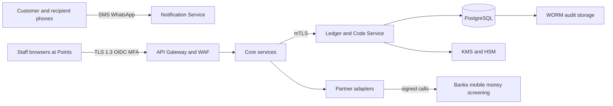

# 1. Purpose and scope

This document defines how **Bantaba Core** is protected, with the **Bantaba Code lifecycle** as the centre of gravity. Bantaba is a remittance company with a technology backbone. The security promise to customers is simple: a code, once redeemed, can never be used again, and a code in the wrong hands is not enough to take money. Everything here serves that promise.

It covers: assets and trust boundaries; a STRIDE analysis of every stage of the code lifecycle; the controls matrix; key management; the role-based access matrix derived from the canonical roles; secure development practice; incident handling; and the scope and rules of engagement for penetration testing. It complements BNT-TEC-01 (architecture), BNT-TEC-02 (code lifecycle and redemption security specification), BNT-TEC-03 (data model and ledger), BNT-TEC-04 (API) and BNT-TEC-06 (infrastructure).

This is a design and planning document. No external certification (ISO 27001, SOC 2 Type II) is held today; both are **targets** (SOC 2 Type II by M18). Nothing here should be read as a claim of certification.

## 1.1 Security objectives

| # | Objective | Measure |
|---|---|---|
| O1 | A code can be redeemed **at most once**, ever | Zero double-payouts; conditional-write proof in BNT-TEC-07 tests |
| O2 | A stolen or guessed code alone cannot release cash | Release always needs OTP (or supervisor exception plus PIN) and human ID check |
| O3 | Money records cannot be silently altered | Ledger append-only; hash-chained audit to WORM storage; daily trial balance |
| O4 | No single employee can move money or read codes alone | Separation of duties and four-eyes on every privileged change |
| O5 | Personal data is minimised, encrypted and access-logged | Field-level tokenisation; access reviews quarterly |
| O6 | Compromise is detected within minutes and contained within an hour | Alert on any lookup of BURNED, VOID or REPLACED code; RTO of 60 minutes |
| O7 | Fraud loss stays below 8 bps of volume (M12 KPI) | Monthly fraud report to the AML/compliance committee |

# 2. System context and trust boundaries

Bantaba is cash-first: the highest-value attack surface is not a website but **people, premises and a handful of staff-facing screens**. The threat model therefore treats social engineering, insider collusion and counter-side abuse as first-class threats, alongside classic application attacks.

## 2.1 Assets

| Asset | Why it matters | Classification |
|---|---|---|
| Plaintext Bantaba Code (exists only in memory at issue, on the sender's receipt and phone) | Bearer instrument; with factors it releases cash | Restricted |
| `code_digest` (HMAC-SHA256 with server pepper) | Lookup key; leak alone does not reveal code | Confidential |
| HMAC pepper, JWT signing keys, KMS CMKs | Root of trust | Restricted (HSM/KMS only) |
| Ledger (`ledger_journals`, `ledger_entries`) | Source of truth for money | Confidential, integrity-critical |
| Sender and recipient PII (ID numbers, phone, DOB, address) | Regulatory and privacy exposure | Confidential (tokenised) |
| Float and till balances | Cash at risk at Payout Points | Confidential |
| Audit log | Evidence for regulators and disputes | Integrity-critical |
| Screening watchlists and alert history | Tipping-off risk if leaked | Restricted |

## 2.2 Trust boundaries

Boundaries: (1) the public internet to the gateway; (2) the gateway to internal services (mTLS); (3) internal services to the data tier and KMS; (4) Bantaba to partners over signed or IP-allow-listed channels; (5) the physical boundary at each Send or Payout Point; (6) the human boundary between a staff member and a customer at the counter.

# 3. STRIDE analysis of the code lifecycle

The lifecycle stages follow BNT-TEC-02: **issue, deliver, lookup, session, second factor, release (burn), cancel, reissue, expiry, lock**. For each stage the table lists the principal threats, the control that answers each, and the residual risk after controls.

## 3.1 Stage 1: Issue (Cashier creates transfer and code is generated)

| STRIDE | Threat | Control | Residual |
|---|---|---|---|
| Spoofing | Attacker uses a stolen cashier session to issue codes against fake cash | MFA, device binding, session timeout 15 min idle; till credited only on cashier-confirmed cash receipt with second staff present on shift | Low |
| Tampering | Staff alters amount after quote | Quote is server-side and immutable; transfer references quote id; amount changes require a new quote | Low |
| Repudiation | Cashier denies issuing a transfer | Append-only `transfer_events`, hash-chained `audit_log`, receipt number tied to till | Low |
| Information disclosure | Plaintext code leaks via logs, crash dumps or staff memory | Plaintext only in memory, never logged (log scrubber with pattern for the code format), shown once, **staff cannot retrieve later** | Low-medium (screen shoulder-surfing) |
| Denial of service | Flood of quotes or transfers exhausts capacity | Rate limits per user and per point; idempotency keys; autoscaling | Low |
| Elevation of privilege | Cashier gains redeem rights | RBAC plus ABAC; Cashier cannot redeem; permissions evaluated by policy engine (OPA or Cedar) | Low |
| Weak randomness (extension of Tampering) | Predictable codes | CSPRNG only; 11 random Crockford characters (55 bits); one check character; unit test that RNG source is `crypto` class; collision retried on unique-index violation | Very low |

## 3.2 Stage 2: Delivery (code reaches the sender, recipient gets notification without code)

| STRIDE | Threat | Control | Residual |
|---|---|---|---|
| Spoofing | SMS sent to attacker-controlled number | Sender phone captured and verified against the ID record at the counter; code is also printed on the receipt | Medium (SIM swap on sender phone) |
| Tampering | Notification rewritten in transit | SMS inherently unauthenticated; message contains no code for recipient, only reference and where to go | Low |
| Information disclosure | Code appears in outbox, provider logs or support tools | Outbox stores the message body encrypted; code-bearing template flagged `sensitive`; provider told to mask in logs; support UI shows "sent" without body | Medium (provider-side logging, contractually mitigated) |
| Denial of service | SMS provider outage | Receipt print is primary; WhatsApp fallback; supervisor can reprint within the **30-minute** window only through reissue | Low |
| Repudiation | Sender claims code never delivered | Delivery receipts stored; printed receipt number logged | Low |

## 3.3 Stage 3: Lookup (Payout Officer enters code)

| STRIDE | Threat | Control | Residual |
|---|---|---|---|
| Spoofing | Attacker poses as an officer | MFA, device binding, **geo-fence 150 m**, IP allow-listing where possible | Low |
| Tampering | Normalisation bypass to probe variants | Server normalises (uppercase, O to 0, I and L to 1, strip dashes and spaces); constant-time digest compare | Low |
| Information disclosure | Lookup response leaks sender or full recipient data | Masked summary only (recipient name, amount, destination currency, status); no sender PII | Low |
| Denial of service | Officer account used to hammer lookups | **5 failed lookups in 10 minutes locks the officer session** and alerts; global rate limits | Low |
| Guess attack | Brute-force random codes | Probability a random guess hits any live code is N divided by 2^55. With 100,000 live codes that is about 2.8 x 10^-12 per guess; at the enforced ceiling of 5 failures per 10 minutes per officer across a fleet of 1,000 compromised officers the expected hits per year are far below 10^-3. Second factors still required even on a hit | Very low |
| Elevation of privilege | Lookup of VOID, REPLACED or BURNED code used to enumerate | Returns state only ("already redeemed on date at point"), raises alert; no extra data | Low |

## 3.4 Stage 4: Redemption session (10-minute soft lock)

| STRIDE | Threat | Control | Residual |
|---|---|---|---|
| Spoofing | Second officer hijacks the session | Session bound to officer id, point id and device; release rejects mismatches with `SESSION_EXPIRED` or `FORBIDDEN` | Low |
| Tampering | Session extended indefinitely | Fixed `session_expires_at`; no renewal; new lookup creates a new session and invalidates the old one | Low |
| Denial of service | Attacker opens sessions to block legitimate payout | Sessions only start on a valid code; the lock lasts 10 minutes; Ops Desk can release a session | Low |
| Race | Two Payout Points pay the same transfer | Session ownership plus the atomic conditional update at burn | Very low |

## 3.5 Stage 5: Second factors (OTP, ID name check, PIN)

| STRIDE | Threat | Control | Residual |
|---|---|---|---|
| Spoofing | Impersonator holding code and shown ID of another person | ID name fuzzy check at 0.80 or above; Band B and C ID photo; OTP goes to the **registered recipient phone**, independent of sender channel; officer training | Medium (forged ID plus recipient phone compromise) |
| Tampering | OTP replay | OTP 6 digits, 10-minute TTL, max 3 attempts, salted hash, single use | Low |
| Information disclosure | OTP sent to wrong number via data entry error | Recipient phone captured twice at the counter and confirmed by the sender; edits after issue need supervisor approval | Low-medium |
| Denial of service | Locking a victim's transfer by failed attempts | **3 failed second-factor attempts lock** the transfer (supervisor and Compliance review); lock is a safe state, not a loss | Medium (nuisance, accepted) |
| Elevation of privilege | Officer waives OTP | No-OTP path exists only as supervisor exception **plus** Secret PIN, logged, Compliance notified | Low |
| SIM swap on recipient phone | Attacker receives OTP | ID check still required; Band C needs supervisor; PIN recommended above $500 | Medium |

## 3.6 Stage 6: Release and atomic burn

| STRIDE | Threat | Control | Residual |
|---|---|---|---|
| Tampering | Concurrent double-redeem | Single conditional update: `WHERE status='AVAILABLE' AND code_state='ACTIVE' AND session_id=$s AND session_expires_at>now()`; rows affected must equal 1 else rollback; ledger journal in the same transaction | Very low |
| Repudiation | Officer or recipient denies payout | Burn writes `redeemed_at`, `redeemed_point_id`, `redeemed_officer_id`; receipt number; Band B and C ID photo retained | Low |
| Replay | Resubmitting a captured release request | `Idempotency-Key` per release: same key returns the original result, different key on a burned code returns `CODE_ALREADY_REDEEMED` | Very low |
| Information disclosure | Release response exposes extra data | Minimal receipt payload; ID photo stored encrypted, not returned | Low |
| Elevation of privilege | Release above band without supervisor | Band C check server-side, not UI-side; supervisor co-approval is an `approvals` row from a different user | Low |
| Float abuse | Payout when float is short | `FLOAT_INSUFFICIENT` block; float never negative (ledger invariant) | Very low |

## 3.7 Stage 7: Cancel, reissue, extension

| STRIDE | Threat | Control | Residual |
|---|---|---|---|
| Spoofing | Impostor claims to be the sender to cancel and take the cash back | Sender ID, receipt and original phone verified; supervisor approval; creator of transfer is not the approver | Medium (social engineering) |
| Tampering | Cancel after the code has been shared and recipient is at the counter | Cancel and redeem race resolved by the burn condition; VOID set transactionally with status check | Low |
| Repudiation | Supervisor denies approving | `approvals` row with approver id, time, reason, device | Low |
| Elevation of privilege | Reissue loops to launder (max 2 reissues) | Cap of 2; alert when reissue follows a failed redemption attempt | Low |
| Information disclosure | Reissue shows the old code | Old code becomes REPLACED (dead); only digest retained; new code shown once | Low |

## 3.8 Stage 8: Expiry and unclaimed funds

| STRIDE | Threat | Control | Residual |
|---|---|---|---|
| Tampering | Expiry job skipped or duplicated | Scheduled workflow with idempotent journal (EXPIRY template); daily control report of AVAILABLE transfers past expiry | Low |
| Elevation of privilege | Staff extends expiry without approval | Single 30-day extension, supervisor only, four-eyes logged | Low |
| Repudiation | Dispute over expiry date | Dates fixed at issue in `codes.expires_at`; reminders to sender logged in the outbox | Low |

## 3.9 Cross-cutting threats

| Threat | Description | Controls |
|---|---|---|
| Insider collusion (cashier plus officer) | Fake send, then redeem with an accomplice | Four-eyes cash handling (2 staff per shift), many-to-one and structuring rules, geo-fence, mystery-shopper audits, float and till reconciliation, ID photo on Band B and C |
| Robbery or coercion at a point | Staff forced to release | Panic button, CCTV, drop-safe, cash caps per till, duress process in the incident SOP (BNT-OPS-08), remote Ops Desk lock of a point |
| Phishing of staff | Credential theft | Passkeys where possible, MFA, no shared logins, conditional access by device |
| Scam victims | Sender coerced to send, scammers collect | Scam warnings on the receipt and the SMS, officer questions at Band B and C, fraud policy (BNT-CMP-13) |
| Supply-chain | Malicious dependency | SCA, lockfiles, signed images, provenance checks |
| Cloud misconfiguration | Public bucket, open port | Terraform policy-as-code, continuous posture scan, deny-by-default security groups |

# 4. Controls matrix

Each row maps a control to the objective(s) it supports, the owner, the evidence produced and the verification frequency.

| ID | Control | Objectives | Owner | Evidence | Frequency |
|---|---|---|---|---|---|
| C-01 | TLS 1.3 external, mTLS between services | O2 O5 | Platform | Config scan, cert inventory | Continuous |
| C-02 | AES-256-GCM at rest with envelope encryption (KMS CMKs) | O5 | Platform | KMS policies, drift report | Continuous |
| C-03 | Field-level tokenisation of PII (ID numbers, phone, DOB) in token vault | O5 | Security | Vault audit, access logs | Quarterly review |
| C-04 | HMAC pepper and JWT signing keys in HSM or KMS | O1 O2 | Security | Key ceremony records | Per rotation |
| C-05 | Digest-only code storage, constant-time compare | O1 O2 | Code Service team | Unit and property tests | Every build |
| C-06 | Atomic conditional burn plus ledger in one transaction | O1 | Ledger and Payout team | Concurrency tests (TC-RED-003 and others) | Every build |
| C-07 | OAuth2/OIDC, MFA mandatory, device binding, passkeys | O2 O4 | Identity | IdP logs | Continuous |
| C-08 | RBAC plus ABAC with least privilege and break-glass | O4 | Security | Policy repo, access review | Quarterly |
| C-09 | Four-eyes on cancel, reissue, extension, Band C, fees, limits, spreads, rules, roles | O4 | Operations and Compliance | `approvals` table | Monthly sample |
| C-10 | Append-only hash-chained audit to S3 Object Lock (compliance mode) | O3 | Platform | `GET /audit/verify` result | Daily |
| C-11 | Ledger triggers deny UPDATE and DELETE; trial balance | O3 | Ledger team | Trial balance, trigger tests | Daily |
| C-12 | WAF, rate limiting, geo-fence 150 m, IP allow-list for Payout Points | O2 O6 | Platform | WAF logs | Continuous |
| C-13 | Officer lockout: 5 failed lookups in 10 minutes | O2 | Payout team | Alert tickets | Continuous |
| C-14 | Transfer lock: 3 failed second-factor attempts | O2 | Payout team | Lock events | Continuous |
| C-15 | Alert on lookup of BURNED, VOID, REPLACED codes | O6 | Risk and Fraud | Alert queue | Continuous |
| C-16 | Sanctions, PEP, velocity, structuring, many-to-one rules | O7 | Compliance | Screening logs | Continuous |
| C-17 | SAST, SCA, secrets and container scanning in CI | O1 to O5 | Engineering | CI reports | Every build |
| C-18 | Annual and pre-launch external penetration test | all | Head of Security | Test report, retest | Annual |
| C-19 | Backups encrypted, restore tested; RPO 5 min, RTO 60 min | O6 | Platform | DR test report | Twice a year |
| C-20 | Log scrubbing for code, OTP, PIN and PII patterns | O5 | Engineering | Unit tests, log review | Every build |
| C-21 | 24/7 on-call, runbooks, 72-hour notification playbook | O6 | Head of Security | Drill records | Twice a year |
| C-22 | Vendor risk management for partners | O5 | Compliance | Due diligence file | Annual |
| C-23 | Physical controls: CCTV, safe, panic button, cash caps | O4 O6 | Operations | Site audit | Quarterly |
| C-24 | Staff security and AML training with attestation | O4 | HR and Compliance | LMS records | Annual |

Standards path: OWASP ASVS Level 2 for the platform, **Level 3 for ledger, code and payout components**; FATF R.16 for payment information; ISO 27001 alignment during Year 1; SOC 2 Type II target M18. PCI scope is minimal: no card data in Phase 1; hosted fields in Phase 2.

# 5. Key management

## 5.1 Key inventory

| Key | Purpose | Store | Algorithm | Rotation | Custodian |
|---|---|---|---|---|---|
| **Code pepper** | HMAC of normalised code to `code_digest` | HSM or KMS (HMAC key, non-exportable) | HMAC-SHA256, 256-bit | Annual and on suspicion; versioned (see 5.2) | Head of Security (split with CTO) |
| JWT signing key | Sign access tokens | KMS asymmetric | ES256 | 90 days, overlap window | Identity team |
| Data CMKs | Envelope encryption of databases, S3, backups | KMS | AES-256-GCM | Annual automatic | Platform |
| Token vault key | Tokenise PII fields | KMS plus vault | AES-256-GCM | Annual | Security |
| OTP salt and PIN hash parameters | Hash OTP and PIN | KMS-wrapped secret | Salted hash; Argon2id for PINs (PBKDF2 acceptable in prototype) | On parameter change | Code Service |
| Webhook signing secret (Phase 2) | `X-Bantaba-Signature` | Secrets manager | HMAC-SHA256 | 180 days, dual secret | Integrations |
| Partner API credentials | Bank, mobile money, SMS | Secrets manager | Provider specific | Per provider policy, at most 180 days | Integrations |
| mTLS certificates | Service identity | Private CA | ECDSA P-256 | 30 days automated | Platform |
| Audit anchor key | Sign daily hash-chain head | KMS asymmetric | ES256 | Annual | Security |

## 5.2 Pepper rotation without losing live codes

Because only the digest is stored, a code cannot be re-hashed under a new pepper. Rotation therefore works as follows:

1. Each `codes` row stores `pepper_version`.
2. A new pepper version is generated in the HSM. **New codes** use the new version.
3. Lookup computes the digest under every **active** version (at most two) and queries once with both values.
4. The old version stops being used for **live** codes only after the longest possible code life has passed: 30 days validity plus 30 days extension plus a safety margin, so **90 days** after the last code was issued under it. Because BURNED, VOID and REPLACED rows keep their digest so that later attempts return "already redeemed" and raise an alert, the old version stays in **verify-only mode** in the HSM for as long as those rows are queryable (default 12 months, matching the unclaimed-funds claim window). Verify-only means the key can compute HMACs for lookup but is never used to issue new codes.
5. Emergency rotation (pepper suspected exposed): issue under the new version immediately; keep the old version verify-only; raise the lookup rate-limit sensitivity; Compliance reviews all redemptions in the window.

## 5.3 Ceremonies and custody

| Rule | Detail |
|---|---|
| Generation | In HSM or KMS only; no plaintext key ever exported to an engineer laptop |
| Split knowledge | Two named custodians approve pepper and audit anchor key operations |
| Access | Via IAM role assumed by the service; no human use of key material; break-glass requires two approvers and is logged |
| Backup | KMS multi-Region keys for DR (eu-west-2 primary, eu-west-1 DR) |
| Destruction | Scheduled deletion with 30-day window and dual approval; retire only after retention and legal hold check |
| Evidence | Key ceremony log stored in the WORM bucket |

# 6. Role-based access matrix

The matrix operationalises the canonical roles. **C** = create, **R** = read, **U** = update, **A** = approve, **X** = execute, **-** = no access. "Own" means own point, till or float. Four-eyes applies to all privileged changes. MFA is mandatory for every staff role.

| Capability | Cashier | Payout Officer | Supervisor | Compliance | Treasury | Ops Desk | Admin | Auditor | Agent |
|---|---|---|---|---|---|---|---|---|---|
| Create quote and transfer | C | - | - | - | - | - | - | - | C if Send Point agent |
| Register sender | C | - | - | R | - | R | - | R | C if Send Point agent |
| View plaintext code after issue | - | - | - | - | - | - | - | - | - |
| View code digest | - | - | - | - | - | - | R | R | - |
| Print receipt | X | X | X | - | - | - | - | - | X |
| Lookup and redeem | - | X | - | - | - | X on behalf during outage | - | - | X (Payout Point agent) |
| Capture OTP and ID | - | X | - | - | - | X | - | - | X |
| Co-approve Band C | - | - | A | R | - | - | - | - | - |
| Request cancel or reissue | C | - | C | - | - | C | - | - | C |
| Approve cancel, reissue, extension | - | - | A | - | - | - | - | - | - |
| Clear compliance hold | - | - | - | A | - | - | - | - | - |
| File SAR or STR | - | - | - | X (MLRO team) | - | - | - | - | - |
| Manage watchlists | - | - | - | U | - | - | - | R | - |
| Set FX mids and spreads | - | - | - | - | C and A (four-eyes) | - | - | R | - |
| Approve float top-up | - | - | - | - | A | - | - | R | - |
| View positions and settlement | - | - | - | R | R | - | - | R | - |
| Close till | X own | X own | A and X | - | - | - | - | R | X own |
| Manage users and roles | - | - | Point staff only | - | - | - | C U with four-eyes | R | - |
| Change configuration, fees, limits | - | - | - | A for limits | A for spreads | - | C with four-eyes | R | - |
| View audit log | - | - | - | R | - | - | R | R | - |
| Read ledger and trial balance | own till | own float | R at point | R | R | - | - | R | own float |
| Write ledger (system journals only) | via workflow | via workflow | via workflow | - | via workflow | - | - | - | via workflow |

Notes. Cashier cannot redeem; Payout Officer cannot create transfers; supervisors cannot see plaintext codes and cannot clear compliance holds; Admin cannot read codes (digests only) and cannot handle money; Auditor has no write path. Ledger writes happen only through workflow service accounts, never through a human role. Agent permissions equal Payout Officer, plus Cashier for a Send Point agent, within tier caps (Sub-agent $700, Agent $4,000, Super-agent $20,000 daily payout).

## 6.1 ABAC conditions layered on RBAC

| Condition | Rule |
|---|---|
| Location | Release and till actions only from a device within 150 m of the registered point |
| Device | Device must be bound to the user and point |
| Time | Staff sessions only within the point's shift roster plus 30 minutes |
| Amount | Band and tier caps evaluated server-side |
| Separation | Approver id must differ from requester id and from transfer creator |
| Data scope | Staff see only their point; HQ roles see by corridor assignment |

## 6.2 Break-glass

A named HQ engineer may obtain time-boxed (60 minutes) production data access through a two-person approval (Head of Security plus CTO or COO). Every command is recorded, the session is replayable, and the event is reviewed by the Auditor within five business days. Break-glass cannot expose plaintext codes because they do not exist in storage.

# 7. Secure development lifecycle

| Phase | Practice |
|---|---|
| Design | Threat model update for each epic touching money, codes or PII; ADR per significant security decision |
| Code | Pull request reviews with security checklist; two reviewers for Ledger, Code and Payout modules; secrets never in repo |
| Build | SAST, SCA, secret scanning, container scanning, IaC scanning; signed images; SBOM generated |
| Test | Security regression suite (BNT-TEC-07); fuzzing on code normalisation and API parsers; property tests on ledger |
| Release | Change approval; staged rollout; automated rollback; no deploys to Payout paths during peak payout hours without incident-commander approval |
| Operate | Vulnerability SLAs: critical 48 hours, high 7 days, medium 30 days, low 90 days |
| Learn | Blameless post-incident review within five business days |

# 8. Detection, monitoring and incident response

## 8.1 Security alerts

| Alert | Trigger | Severity | Response |
|---|---|---|---|
| Dead-code lookup | Lookup of BURNED, VOID, REPLACED or EXPIRED code, especially from another point | High | Compliance and Ops Desk review within 1 hour |
| Officer brute-force | 5 failures in 10 minutes | High | Session locked; supervisor call |
| Release outside geo-fence | Device beyond 150 m | High | Block, investigate device |
| Reissue after failed attempt | Reissue within 24 hours of a failed redemption | High | Hold reissue for Compliance |
| Ledger imbalance | Trial balance non-zero in any currency | Critical | Page incident commander; freeze releases if needed |
| Audit chain break | `GET /audit/verify` fails | Critical | Security incident |
| Float breach | Float below 20% of target | Medium | Treasury top-up |
| Privileged change without second approver | Impossible by design; alert if config store differs from approved state | Critical | Security incident |

## 8.2 Incident process

Severity levels SEV1 to SEV4. SEV1 (confirmed double-payout, ledger breach, key exposure, bulk PII exposure) has an incident commander within 15 minutes, a regulator and legal assessment within 24 hours, and **72-hour notification** windows for personal data breaches under UK GDPR (and equivalent obligations elsewhere). Runbooks cover: suspected pepper exposure, mass code compromise (freeze all lookups, reissue on demand), partner outage, insider fraud, robbery (with BNT-OPS-08), SMS provider compromise. Tabletop exercises twice a year.

## 8.3 Fraud-linked containment levers

| Lever | Effect | Who can pull it |
|---|---|---|
| Lock a transfer | Moves to LOCKED, supervisor and Compliance review | Compliance, Ops Desk |
| Suspend a point | Blocks lookups and release at the point | Ops Desk with Compliance approval |
| Suspend an officer | Revokes sessions and device binding | Supervisor, Admin |
| Global payout pause | Stops release network-wide | Incident commander |
| Corridor limit reduction | Lowers caps through four-eyes config change | Compliance and Treasury |

# 9. Penetration test scope and rules of engagement

## 9.1 Cadence

Annual external test and a **pre-launch test in Phase 2 (M7 to M8)** before the closed pilot at M9. Retest of all high and critical findings. Internal red-team exercise of counter scenarios in Year 2.

## 9.2 In scope

| Area | Targets | Priority |
|---|---|---|
| Code lifecycle | Issue, lookup, session, OTP, release, cancel, reissue, expiry | Highest |
| Staff Console | Authentication, session handling, RBAC bypass, IDOR on transfers, senders, tills | Highest |
| Payout flow | Race conditions on release, replay of release requests, band bypass, geo-fence spoofing, device binding | Highest |
| API | All endpoints in BNT-TEC-04, rate limits, idempotency, error leakage | High |
| Recipient tracker and public track endpoint | Enumeration of references, data leakage, scraping | High |
| Ledger | Direct write attempts, trigger bypass, trial balance manipulation | High |
| Partner adapters | Webhook signature validation, SSRF, credential handling | Medium |
| Cloud | IAM, network, secrets, S3 Object Lock configuration, Kubernetes | High |
| Mobile app (Phase 2) | Storage, pinning, tampering | Later round |

## 9.3 Specific test objectives

1. Redeem a code twice, including across two points at the same instant.
2. Redeem with a valid code but without OTP; with expired OTP; with another recipient's OTP.
3. Brute-force or enumerate codes and transfer references within rate limits.
4. Obtain a plaintext code from any storage, log, support tool, backup or notification outbox.
5. Escalate from Cashier to Payout Officer or from Supervisor to Compliance.
6. Self-approve a cancel or reissue; approve with a second account controlled by the tester.
7. Alter or delete ledger or audit entries; forge a hash-chain continuation.
8. Bypass the geo-fence and device binding from outside the premises.
9. Extract PII through the tracker, errors or timing differences.
10. Abuse idempotency keys to create duplicate transfers or duplicate payouts.

## 9.4 Out of scope and rules

Out of scope: partner production systems, bank core systems, SMS carrier infrastructure, social engineering of customers, physical intrusion at live Points unless separately authorised in writing, denial-of-service at volume against production. Testing runs against a production-like staging environment with synthetic data; any production testing needs written approval and a rollback plan. Testers must be CREST or equivalent accredited (verify). Findings are rated with CVSS plus a Bantaba money-impact modifier; **any path to double-redeem or plaintext code exposure is automatically Critical**. Exit criteria for launch: zero open Critical or High findings; Medium findings with an accepted remediation date.

# 10. Data protection by design

| Topic | Approach |
|---|---|
| Minimisation | Collect what regulation requires (BNT-CMP-03); no card data in Phase 1 |
| Retention | At least five years after the relationship ends (PRC rules may require 10 years for outbound transfer records) |
| Access | Purpose-bound, logged; PII views mask by default (phone shows last 3 digits, ID shows last 4) |
| Cross-border | UK primary region; Gambia and other data flows documented in BNT-CMP-06; PRC data localisation assessment before any China collection |
| Subject rights | Export and erasure tooling reconciled with AML retention duties |
| Privacy review | DPIA before launch in each jurisdiction |

# 11. Residual risk summary

| Risk | Rating after controls | Owner | Next step |
|---|---|---|---|
| Insider collusion across both ends | Medium | COO | Mystery-shopper programme, analytics on cashier and officer pairs |
| SIM swap on recipient phone | Medium | CTO | Add PIN prompt above $500; evaluate carrier SIM-swap signals |
| Forged ID at payout | Medium | Head of Compliance | ID capture quality, officer training, Phase 2 document verification |
| SMS provider logging of code-bearing messages | Medium | CTO | Provider contract clauses, WhatsApp as alternative |
| Scam-induced sends | Medium | MLRO | Warnings and officer prompts, fraud policy |
| Pepper compromise | Low | Head of Security | HSM custody, rotation runbook |

# 12. Open items / assumptions to validate

- Choice of HSM (cloud HSM versus KMS-only HMAC key) and whether the HMAC pepper can be non-exportable in the chosen service.
- Whether WhatsApp Business messages can be configured so provider logs omit message bodies.
- Pen-test provider selection, accreditation requirements and budget (inside the $1.2M product and engineering allocation).
- Carrier SIM-swap signal availability in The Gambia (assumed unavailable at launch).
- Whether SOC 2 Type II by M18 is achievable alongside Year 2 corridor launches.
- Legal view on retention of ID photos in the Gambia and UK GDPR lawful basis (counsel to confirm).
- Vulnerability SLA targets are proposed, not yet approved by the board audit and risk committee.
