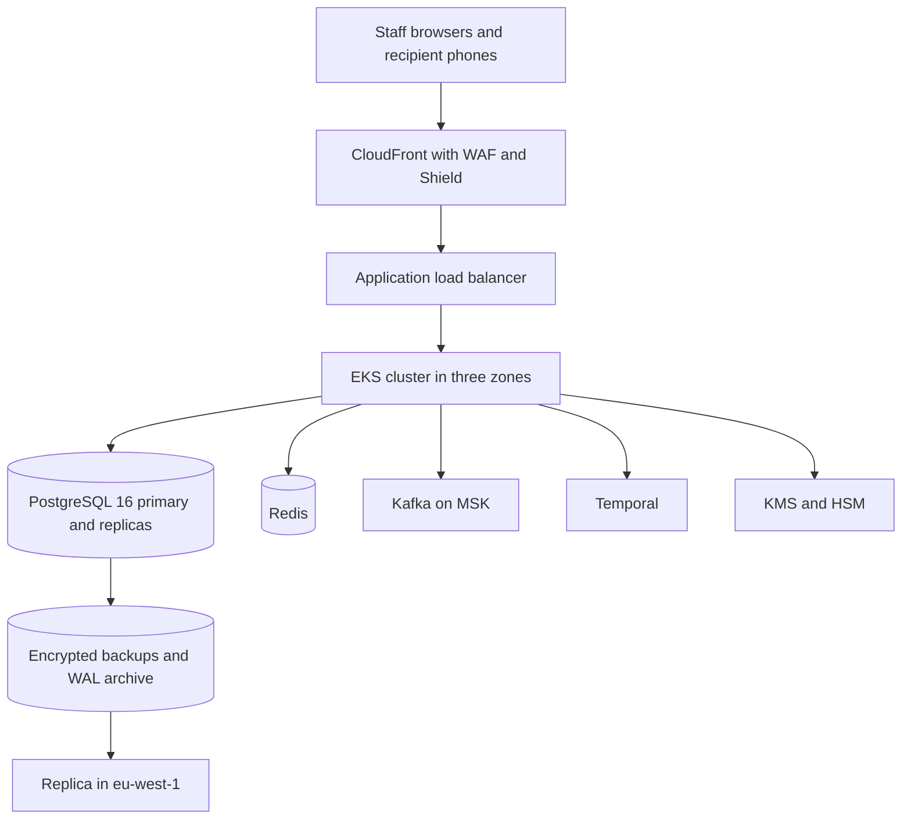

# 1. Purpose and principles

This document describes where **Bantaba Core** runs, how it is built and released, how it is observed, and how it recovers from failure. Bantaba is a remittance company; its technology is a back-office tool that must be dependable at a counter in Serrekunda or Birmingham at the moment a family member is waiting for cash. Reliability is judged at the counter, not on a dashboard.

Design principles:

| # | Principle | Consequence |
|---|---|---|
| P1 | **Boring and managed first** | Use managed AWS services (RDS or Aurora PostgreSQL, MSK, ElastiCache, KMS) before self-hosting anything |
| P2 | **The ledger is the source of truth for money** | Strongest durability and backup posture is applied to PostgreSQL and the audit store |
| P3 | **Online-only payout** | Because release is online-only (no offline release), availability and latency of the payout path are first-order concerns, and the outage fallback is a voice-verified remote redemption by the Ops Desk |
| P4 | **Everything as code** | Terraform for infrastructure, Helm or Kustomize for workloads, policy-as-code for guardrails |
| P5 | **Start as a modular monolith** | Fewer deployables in Phase 1; extract Ledger, Payout and FX at proven seams (see BNT-TEC-01) |
| P6 | **Small team, big blast-radius awareness** | Automation and runbooks replace headcount; changes to the payout path are gated |

# 2. Service level objectives

| SLO | Target | Measured at |
|---|---|---|
| API availability | **99.95%** monthly (about 22 minutes of allowed downtime) | Gateway, synthetic checks from UK and Gambia |
| Quote latency | P95 < 300 ms | Server side |
| Transfer creation | P95 < 600 ms | Server side |
| Redemption lookup | P95 < 400 ms | Server side |
| Ledger post | P99 < 100 ms | Ledger service |
| Counter redemption end to end | P95 < 10 minutes | Business metric (includes human steps) |
| Notification dispatch | 95% handed to provider within 30 seconds | Outbox lag |
| RPO | **5 minutes or less** | Backup and replication metrics |
| RTO | **60 minutes or less** | DR drills |

Error budgets: 0.05% per month on the availability SLO. If the budget is burned, feature releases stop until reliability work restores it.

# 3. Cloud topology

## 3.1 Regions and accounts

| Item | Decision |
|---|---|
| Primary region | AWS **eu-west-2 (London)** |
| DR region | AWS **eu-west-1 (Ireland)** |
| Latency option | **af-south-1 (Cape Town)** considered for a read-mostly payout edge if Gambian latency measurements justify it; decision deferred to the closed-pilot data (M9 to M10) |
| Accounts (AWS Organizations) | `bantaba-mgmt`, `bantaba-security` (logs, GuardDuty, audit WORM), `bantaba-shared` (CI, registries), `bantaba-dev`, `bantaba-stg`, `bantaba-prod`, `bantaba-dr` |
| Isolation | Separate accounts per environment; no human IAM users in prod; SSO with MFA and short-lived roles |
| Data residency | UK/EU regions hold personal data; the PRC data localisation assessment gates any China-collected data (BNT-CMP-06) |

## 3.2 Runtime layout

| Layer | Component | Notes |
|---|---|---|
| Edge | CloudFront, AWS WAF, Shield Standard (Advanced considered after launch), Route 53 health checks | WAF managed rules plus custom rules for code lookup paths |
| Network | One VPC per environment; three AZs; private subnets for workloads and data; NAT egress with allow-listed destinations; VPC endpoints for AWS services | Security groups deny by default; egress to partners through fixed IPs so partners can allow-list Bantaba |
| Compute | EKS with managed node groups (on-demand for payout and ledger, spot allowed for batch) | Pod security standards restricted; network policies; mTLS through a service mesh or sidecar-less mTLS |
| Data | PostgreSQL 16 (Aurora or RDS Multi-AZ), Redis (sessions, rate limits, idempotency cache), Kafka on MSK (outbox relay, events), Temporal (saga orchestration) | Ledger tables in a dedicated database with stricter roles |
| Storage | S3 for documents (ID photos, receipts), WORM audit bucket with **Object Lock compliance mode**, KMS-encrypted | Lifecycle rules enforce retention of at least five years |
| Secrets and keys | KMS CMKs, HSM-backed HMAC pepper, Secrets Manager | Detail in BNT-TEC-05 |
| Observability | OpenTelemetry, Grafana (metrics, logs, traces), Sentry, PagerDuty | Log scrubbing before storage |

## 3.3 Environments

| Environment | Purpose | Data | Access |
|---|---|---|---|
| Local | Developer laptop with containers | Synthetic | Engineers |
| Dev | Integration of feature branches | Synthetic | Engineers |
| Staging | Production-like; partner sandboxes; load tests; pen tests | Synthetic only | Engineers, QA, testers |
| Production | Live | Real | Service accounts only; break-glass for humans |
| DR | Warm standby in eu-west-1 | Replicated | Automation only |
| Pilot flag | Closed pilot cohort uses production with feature flags and the $65k volume cap, not a separate stack | Real | Same as production |

# 4. Capacity and sizing

Planning figures come from the financial canon: 5,130 transfers in Year 1 and 179,229 in Year 2, 943,399 by Year 5. The system is therefore small by internet standards, but **peaks are concentrated**: Friday and weekend afternoons in the UK, paydays, Eid, Christmas and the start of school terms.

| Item | Year 1 | Year 2 | Year 5 (stress target) |
|---|---|---|---|
| Transfers per year | 5,130 | 179,229 | 943,399 |
| Average per day | 14 | about 490 | about 2,580 |
| Assumed peak multiplier | 10x | 10x | 10x |
| Peak transfers per hour (assume 12 trading hours a day) | about 12 | about 410 | about 2,150 |
| Peak redemptions per hour | similar | similar | similar |
| Load-test target (design headroom) | 100 per hour | 1,000 per hour | 5,000 per hour |

Load tests are sized at roughly twice the Year 5 peak so that growth and seasonal spikes do not force a re-architecture. Because the dominant load is human-paced, **correctness under concurrency matters more than throughput**: the key test is many officers hitting the same code at once, not one million requests a second.

Initial production sizing (Phase 1): three-node EKS node group (m6i.large class), PostgreSQL Multi-AZ at 4 vCPU and 16 GB with storage autoscaling, Redis with one replica, MSK with three small brokers. Estimated infrastructure run-rate is a planning assumption to be validated against the finance model (open item).

# 5. Delivery pipeline (CI/CD)

## 5.1 Branching and environments

Trunk-based development with short-lived branches; every merge to main is deployable. Release trains are weekly in Phase 1; hotfixes any time with incident-commander approval. **Payout-path freeze windows**: no non-emergency deploys to Payout, Code or Ledger services during the UK Friday 14:00 to 20:00 and Gambian Friday midday peaks.

## 5.2 Pipeline stages

| Stage | Tooling (planned) | Gate |
|---|---|---|
| Commit | Pre-commit hooks: lint, format, secret scan | Fail blocks push |
| Build | TypeScript and Go builds; reproducible containers; SBOM | Build must be hermetic |
| Static analysis | SAST, SCA, license check, IaC scan (Terraform), container scan | No critical or high findings |
| Unit and property tests | Jest, Go test, property-based tests for ledger and code (BNT-TEC-07) | 100% pass; coverage thresholds in BNT-TEC-07 |
| Integration tests | Containers with PostgreSQL, Redis, Kafka, Temporal; partner mocks | 100% pass |
| Contract tests | OpenAPI conformance for BNT-TEC-04; adapter contract tests (BNT-TEC-10) | No breaking change without version bump |
| Deploy to staging | Argo CD or Flux (GitOps) | Automatic |
| End-to-end and concurrency suite | Playwright, k6 | Must pass, including double-redeem tests |
| Approval | Two reviewers for payout, ledger and code changes; change record | Human gate |
| Production deploy | Progressive: canary at 5%, 25%, 100% with automatic rollback on SLO regression | Automatic |
| Post-deploy | Synthetic transfer-and-redeem against a test point | Must pass or rollback |

## 5.3 Database migrations

Expand-and-contract migrations only; backward-compatible for one release; **ledger tables keep UPDATE and DELETE denied by trigger**, and migrations never rewrite ledger rows (corrections are new reversing journals). Migration tool is run by a dedicated role with a time-limited credential and logged to the audit trail. Rollback of a schema change is a forward fix, not a restore, unless data corruption is proven.

## 5.4 Feature flags and pilot controls

Feature flags control corridor enablement, point enablement, limit tiers and new screens. Flags are configuration under four-eyes control (see BNT-TEC-05). The closed pilot (M9 to M10: 200 invited senders, 20 points, **$65k volume cap**, $400 per transfer) is enforced by flags and caps, not by trust.

# 6. Observability

## 6.1 Signals

| Signal | Examples | Alert |
|---|---|---|
| Golden signals | Latency, error rate, saturation per service | Page on SLO burn |
| Business | Transfers created, codes issued, redemptions, burn failures, time from available to redeemed | Dashboard; alert on unusual ratios |
| Money integrity | Trial balance per currency, journals unbalanced (must be zero), float negative (must be zero) | Page immediately |
| Code lifecycle | Lookups of BURNED, VOID, REPLACED codes; lockouts; reissue rate | Page security on-call |
| Partners | Adapter latency, error codes, webhook lag, settlement file arrival | Ops alert |
| Queues | Outbox lag, Kafka consumer lag, Temporal task backlog | Page when over threshold |
| Cost | Daily spend by account and service | Finance alert on 20% jump |

## 6.2 Logging rules

Structured JSON logs with request id, user id, point id and transfer id. **Never log** plaintext codes, OTPs, PINs, full ID numbers, full phone numbers or full names in error text. A log scrubber and tests enforce this (see BNT-TEC-05 control C-20). Logs retained 13 months hot-warm, with security-relevant logs archived to the WORM bucket for the required retention.

## 6.3 On-call

| Item | Plan |
|---|---|
| Rota | Primary and secondary engineer, plus an incident commander and a business duty manager; 24/7 from the closed pilot (M9) |
| Hours that matter | UK evenings and weekends, Gambian daytime (Gambia is UTC+0 all year; UK shifts between UTC+0 and UTC+1) |
| Tooling | PagerDuty, status page, runbook wiki, Slack incident channel |
| Targets | Acknowledge in 5 minutes, incident commander in 15 for SEV1 |
| Support | Ops Desk is first line for counter issues and can invoke remote redemption |

# 7. Backup, replication and disaster recovery

## 7.1 Objectives and approach

**RPO 5 minutes or less; RTO 60 minutes or less.** The DR approach is **warm standby in eu-west-1**: infrastructure defined in Terraform and kept patched, a PostgreSQL cross-region replica, replicated S3 buckets and KMS multi-Region keys, with compute scaled to minimum and scaled up on failover.

| Asset | Backup or replication | RPO | Restore method |
|---|---|---|---|
| PostgreSQL (ledger and operational) | Continuous WAL archiving, point-in-time recovery, cross-region replica | 5 minutes or less (target near zero within region) | Promote replica or restore to timestamp |
| S3 documents and audit | Cross-region replication; Object Lock on audit | 15 minutes | Switch bucket alias; WORM cannot be deleted |
| Kafka | Outbox is the source; events replayable from the database | Not required separately | Rebuild topics from the outbox |
| Redis | Ephemeral: rebuilt; sessions re-established | None | Re-warm |
| Temporal | Persisted in PostgreSQL | As PostgreSQL | Restore with the database |
| Secrets and keys | Multi-Region KMS keys; Secrets Manager replication | None | Automatic |
| Infrastructure | Terraform state in versioned, replicated bucket | None | Re-apply |

## 7.2 Failure scenarios

| Scenario | Impact | Response | Target |
|---|---|---|---|
| Single pod or node loss | None expected | Autoscaling, readiness probes | Seconds |
| AZ loss | Brief latency | Multi-AZ failover for database and nodes | Under 5 minutes |
| Primary database failure | Writes blocked | Automatic Multi-AZ failover | Under 5 minutes |
| Regional outage (eu-west-2) | Platform down | Invoke DR runbook: promote eu-west-1 replica, scale up, repoint DNS | **Under 60 minutes** |
| Data corruption or bad migration | Possible incorrect state | Point-in-time restore into a side database; replay; reconcile against bank statements | Hours, with a manual control |
| Ransomware or malicious deletion | Data loss attempt | Immutable backups and Object Lock; rotate credentials; rebuild from Terraform | Hours |
| Partner (bank, mobile money, SMS) outage | Specific rails fail | Adapter circuit breaker, fallback provider, queue and retry | Per partner SLA |
| Internet loss at a Payout Point | That point cannot release | Supervisor phones Ops Desk for voice-verified remote redemption; officer may use a mobile hotspot | Minutes |
| Loss of Gambia-side connectivity at large | Payout interrupted | Keep codes valid (30 days); customer notice; extend as needed on supervisor approval | Hours to days |

## 7.3 Offline posture

Bantaba **does not allow offline release** at Payout Points: a burn can only occur by the central conditional write. When the platform is unavailable, no cash is released against codes except through the voice-verified remote process once the platform (or its DR copy) is available to record the burn. Cashiers cannot issue offline either, because codes come from the Code Service. Send Points hold a paper **outage log** for cash collected during a platform outage and sell nothing until systems return, unless the COO approves a manual continuity mode in BNT-OPS-08. This trade-off is accepted: slower service in rare outages in exchange for the burn guarantee.

## 7.4 DR testing

| Test | Frequency | Pass criteria |
|---|---|---|
| Backup restore into isolated account | Monthly | Restore completes; checksum and trial balance match |
| Region failover game day | Twice a year, first before the closed pilot | RTO under 60 minutes; RPO under 5 minutes; trial balance zero; synthetic redeem works |
| Partner outage drill | Quarterly | Fallback and communications work |
| Tabletop for ransomware and insider scenarios | Twice a year | Actions logged; gaps tracked |

After any failover, the reconciliation procedure compares the ledger to the last bank and partner statements and to till counts before normal service resumes (BNT-OPS-04 and BNT-OPS-05).

# 8. Reconciliation as an infrastructure function

The daily three-way reconciliation (internal ledger, bank and partner statements, till counts) runs as a scheduled workflow. It is infrastructure, because a failed or late run is an operational incident.

| Step | Input | Output | Timing |
|---|---|---|---|
| Ingest statements | Bank and partner files and APIs (BNT-TEC-10) | Normalised statement lines | By 07:00 UTC |
| Match | Ledger journals and bank lines by reference, amount, date | Matched, unmatched, tolerance breaks | By 08:00 UTC |
| Till check | Closed tills versus ledger TILL accounts | Over and short entries | After till close |
| Report | Exceptions to Treasury and Operations | Daily reconciliation report | By 09:00 UTC |
| Escalation | Unmatched items older than one business day | Ticket and Treasury review | Same day |

UK safeguarding obligations introduced with the FCA safeguarding changes effective 7 May 2026 (daily reconciliation of safeguarded funds and related returns) may apply; counsel to confirm for a money-remittance-only firm (see BNT-CMP-01). The pipeline is built so a daily safeguarding reconciliation is a configuration change, not a rewrite.

# 9. Security operations in infrastructure

| Control | Implementation |
|---|---|
| Identity | AWS IAM Identity Center with MFA; role per function; no long-lived keys; access reviews quarterly |
| Network | WAF; private subnets; egress allow-list; no public database endpoints; admin access via SSM Session Manager with recording |
| Threat detection | GuardDuty, Security Hub, CloudTrail organisation trail to the WORM bucket, Config rules |
| Vulnerability management | Weekly image rebuilds; SLA per BNT-TEC-05; node patching monthly or faster for critical |
| Secrets | Secrets Manager; rotation automated; no secrets in repos or environment files |
| Policy as code | OPA or Kyverno in cluster; Terraform checks (e.g. no public S3, encrypted volumes) |
| Supply chain | Signed images; admission control only for signed images; pinned dependencies |
| Backups | Cross-account vault with deletion protection |

# 10. Cost management

| Lever | Approach |
|---|---|
| Right-sizing | Start small; review monthly; savings plans after 6 months of stable use |
| Environments | Dev and staging scale to zero outside working hours |
| Data | Lifecycle rules move documents to infrequent access after 90 days (retention stays) |
| Observability | Sampling on traces; retention tiers |
| Reporting | Cost allocation tags per service and per environment; weekly report to CTO and CFO |

Infrastructure and tooling costs sit inside the Product and engineering line of the Seed use of funds ($1.2M, 30%); the figure for Phase 1 is a planning assumption.

# 11. Release and change management

| Change class | Examples | Approval | Window |
|---|---|---|---|
| Standard | Feature behind a flag, copy changes | Peer review | Any time except freeze |
| Normal | Service release, schema expansion | Tech lead plus QA sign-off | Weekly train |
| Payout-critical | Changes to Code, Ledger, Payout, geo-fence | Two reviewers plus Head of Security | Off-peak only |
| Emergency | Security fix, outage repair | Incident commander | Immediate; retro within 5 days |
| Configuration | Fees, limits, spreads, rules | **Four-eyes** in the console | Versioned; effective-dated |

# 12. Runbook index

| Runbook | Trigger | Owner |
|---|---|---|
| RB-01 Region failover | Primary region down | Platform lead |
| RB-02 Database restore and PITR | Corruption or deletion | Platform lead |
| RB-03 Partner outage | Adapter circuit open | Integrations lead |
| RB-04 Pepper rotation (planned and emergency) | Schedule or suspicion | Head of Security |
| RB-05 Global payout pause and resume | SEV1 | Incident commander |
| RB-06 Ledger imbalance | Trial balance non-zero | Ledger lead and CFO |
| RB-07 Outbox backlog | Notification lag | Platform lead |
| RB-08 Certificate and secret rotation failure | Expiry alarms | Platform lead |
| RB-09 Remote redemption support (outage) | Payout Point offline | Ops Desk |
| RB-10 Peak-day readiness (Eid, Christmas, term starts) | Calendar | Engineering manager |

# 13. Open items / assumptions to validate

- Aurora PostgreSQL versus RDS PostgreSQL: final selection after performance tests with the ledger trigger set.
- af-south-1 edge for payout: depends on measured latency from Gambian Points (assumed acceptable from London; to be measured in the pilot).
- Cost of cloud HSM versus KMS-only HMAC; effect on the product and engineering budget.
- Whether a Gambian-hosted component is required by local data rules (status to verify).
- Safeguarding reconciliation scope for a money-remittance-only firm (counsel).
- Peak multiplier of 10x is an assumption; validate with pilot data.
- Manual continuity mode at Send Points during a platform outage is a proposal needing COO and MLRO approval.
